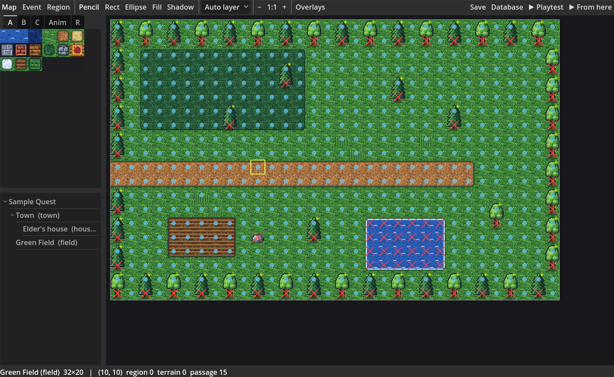
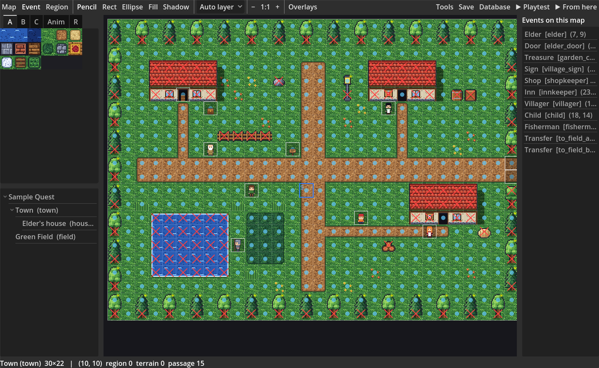
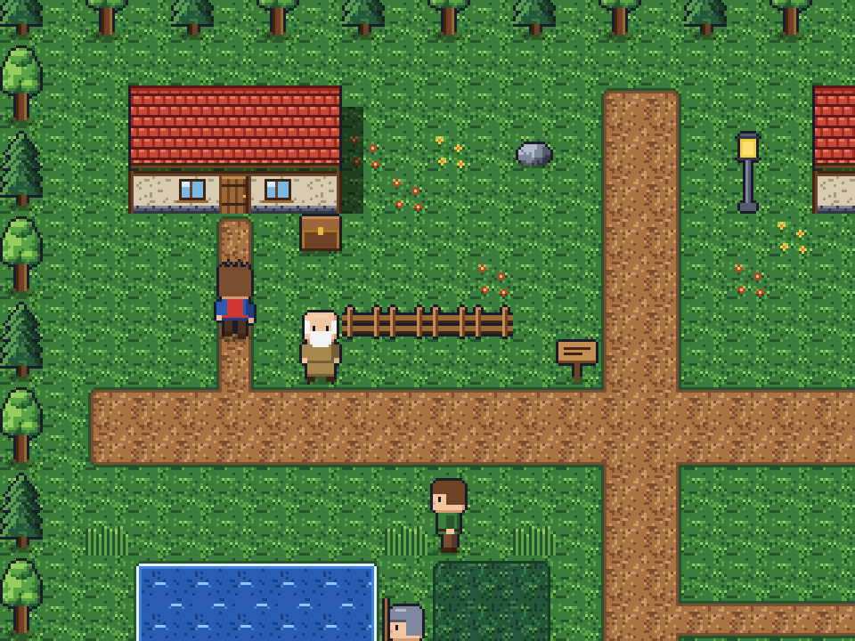
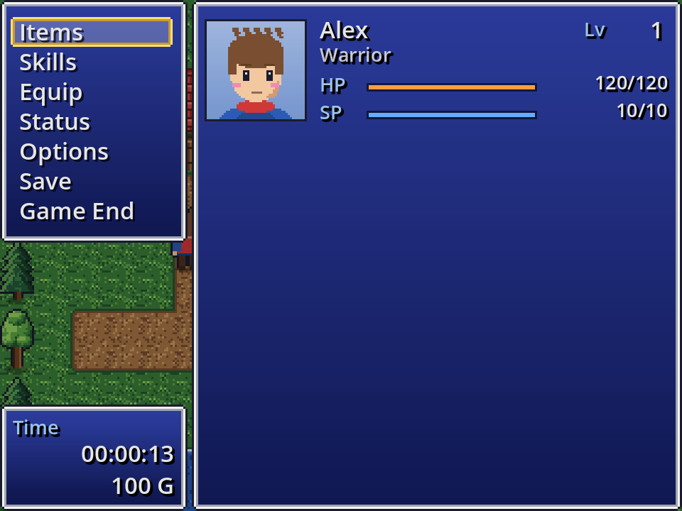
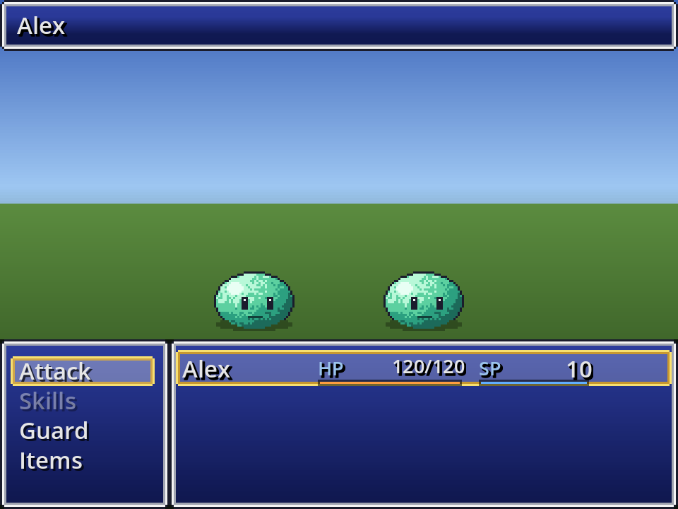
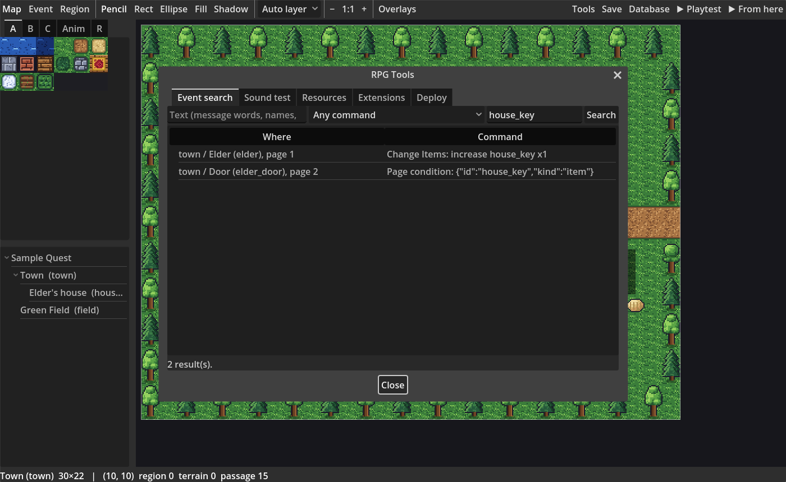
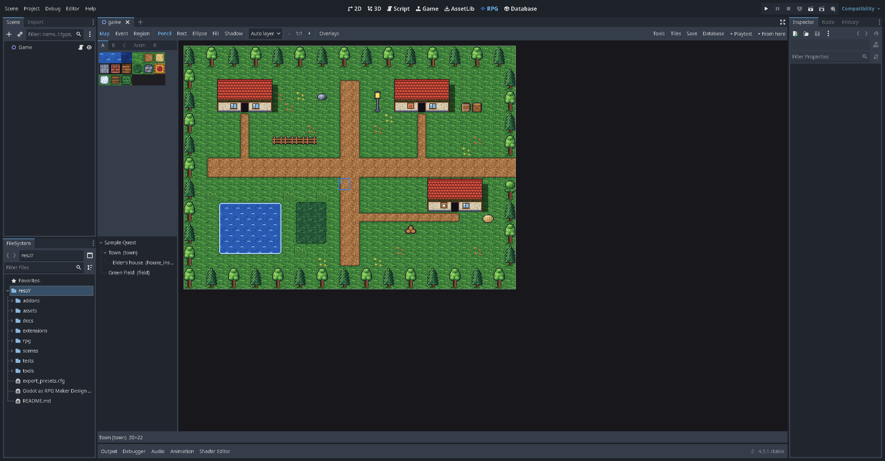
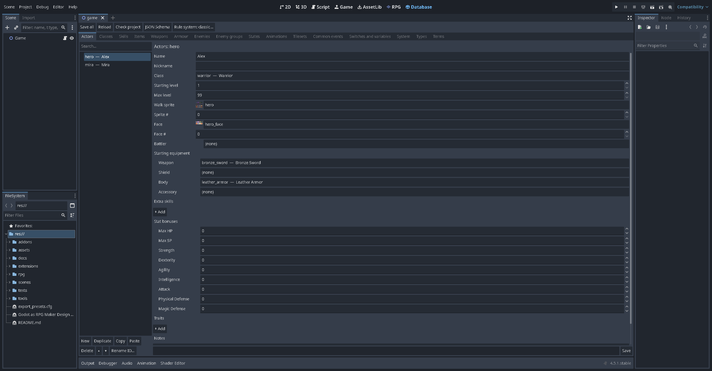
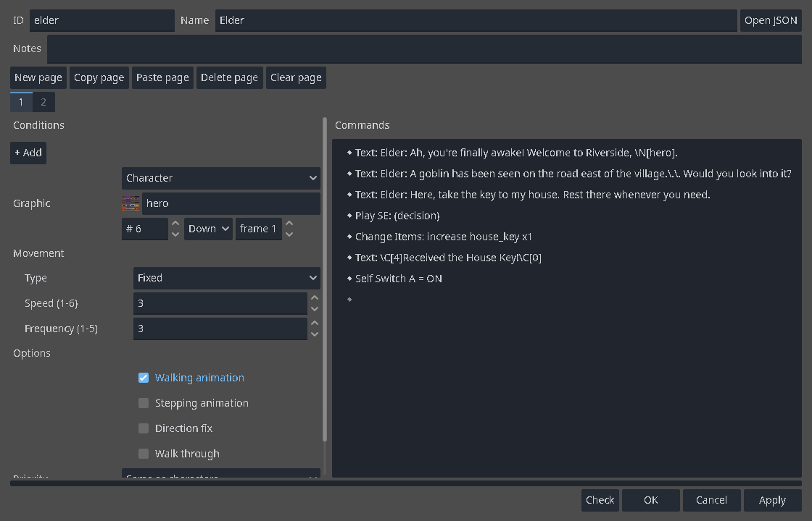
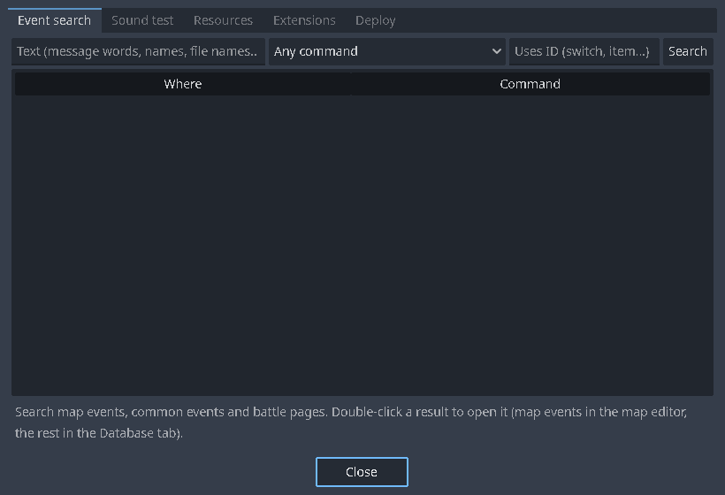

# RPG Kit (working title)

An RPG Maker style workflow inside **Godot 4.5**, built from `Godot as RPG Maker Design Spec.md`:

- autotile map painting
- events made with forms and quick-event templates
- a JSON database
- a default runtime (message box, menus, shop, saves, front- or side-view battles, turn based or ATB) you can replace piece by piece with ordinary Godot scenes and scripts

This folder is a Godot project and also the addon's development home:

- `addons/rpg/` and `addons/rpg_database/` are the addon.
- `rpg/`, `assets/`, `extensions/project/` and `scenes/` are a small sample game, *Sample Quest*.

**Documentation:** the [wiki](docs/wiki/Home.md) covers installation, eight step-by-step lessons (maps, events, story, cutscenes, database, battles, sharing) and a reference.

New to making games? Start with [addons/rpg/docs/MAKER_GUIDE.md](addons/rpg/docs/MAKER_GUIDE.md).

| Map editor | Event mode with passability overlay |
| --- | --- |
|  |  |
| **In game** | **Menu** |
|  |  |
| **Battle** | **Tools: event search** |
|  |  |
| **Inside the Godot editor: RPG tab** | **Database tab** |
|  |  |
| **Event editor (real editor)** | **Tools window (real editor)** |
|  |  |

The screenshots are produced by `tools/screenshot.gd` and `tools/editor_preview.gd` (see *Tests*). The last four come from the real editor, using `RPG_EDITOR_SHOT=<folder>`.

## Requirements

- Godot **4.5.1** (standard or .NET build; the addon is pure GDScript). Earlier versions are untested. The test runner uses the `Logger` API added in 4.5.
- No other dependencies. The starter graphics and sounds in `assets/starter/` are generated by `tools/generate_starter_assets.gd` and dedicated to the public domain (CC0).
- The starter icons (items, weapons, armour, skills, states, elements) are generated by `tools/generate_icons.gd`, also CC0: our own pixel art, not RPG Maker's icons. Database records pick one with the **Icon** field (a grid of the sheet, searchable by name). Menus, the shop, battle lists and the `\I[n]` message code draw them. *System > Icon sheet* switches to another IconSet-style sheet; *System > Show icons* off gives the old look without icons.

## Quick start for makers

1. Open the folder in Godot.
   - The **RPG** and **Database** tabs appear next to 2D / 3D / Script.
   - If they don't, enable *RPG Kit* in *Project > Project Settings > Plugins*. It turns on the Database tab by itself.
   - To use the addon in your own Godot project, copy `addons/rpg/` and `addons/rpg_database/` into it (and `assets/starter/` for the starter art), enable the plugin, and press **Create RPG project** on the RPG tab. That writes a starter database, the Classic rules and a first map into `res://rpg/`. Pick a **Style** first: RPG Maker 2000/2003 (320×240), VX / VX Ace (544×416) or MV (816×624).
   - Coming from RPG Maker? [Following the RPG Maker tutorials in RPG Kit](addons/rpg/docs/RPG_MAKER_TUTORIALS.md) maps RPG Maker's menus, tabs and commands to RPG Kit's.
2. **RPG tab: the map editor.**
   - It looks like RPG Maker's window. A menu bar (Project, Edit, Mode, Draw, Layer, Scale, Tools, Game, Help) and an icon toolbar sit above the map. **Maker view** hides Godot's own docks while you're on the RPG or Database tab; turn it off in *Project > Maker view*.
   - Shortcuts: F8 opens the Database, F9 or Ctrl+R playtests, and Ctrl+= / Ctrl+− zoom. The map tree's right-click menu has *Shift*, *Load sample map* and *Generate dungeon*.
   - **Left:** the tile palette above the map tree. Tabs: A, B, C and Anim for 2000/2003 tilesets; A, A5, B, C, D and E for VX/Ace/MV tilesets; R for regions. Right-click the tree to add, copy, delete or edit maps.
   - **Toolbar:**
     - Modes: **Map** (F5), **Event** (F6), **Region** (F7).
     - Tools: Pencil, Rect, Ellipse, Fill, Shadow.
     - **Auto layer** puts each tile on the right layer for you. Pick *Layer N* to edit one layer on its own.
     - **Overlays** show the grid, passability, regions and terrain tags.
   - Right-click a tile to pick it up (eyedropper). Undo and redo use Godot's own history (Ctrl+Z / Ctrl+Y).
   - **Tiles** opens the tileset's tile settings: passability (on/off or per direction), star, bush, counter, ladder, damage floor and terrain tags, as in RPG Maker's Tilesets tab. They are stored in `rpg/tileset_overrides/` and survive reimport.
3. **Events.**
   - In Event mode, double-click a tile to create an event, or right-click > *Quick event* for Door, Treasure, Inn, Sign, Shop or Transfer.
   - Double-click an event to open the **event editor**: pages, conditions, graphic, trigger, priority, movement and the command list.
   - Each command is edited in a form. There is a JSON view for power users.
   - Location fields (Transfer, Set event location) have **Click on the map...**: the target map opens and you click the tile.
   - A move route's **Preview** draws the path on the map.
4. **Database tab.** Actors, classes, skills, items, weapons, armour, enemies, enemy groups (with **Battle test**), states, terms, system, tilesets, and switches and variables.
   - Renaming an ID updates every reference.
   - Deleting a record retires its ID, so the ID is never reused.
   - **Rule system...** switches rule systems with a preview of every stat, resource, formula and command it affects. A backup is written first and nothing is deleted.
   - States work on the map too. A state can be **Removed by walking** after a number of steps on foot (not in a vehicle), and can **Change while walking** (RPG Maker 2000 style: HP or MP damage or recovery every N steps). With VX Ace style rules, regeneration traits and each state's damage each turn apply every 20 steps, and state turns count down. **System > Knockout by slip damage** (off by default) lets this damage knock actors out, and the game is over when the whole party falls; when it's off, at least 1 HP is left. Damage floors take **System > Damage floor** HP per step and never knock anyone out.
5. **Playtest.**
   - **▶ Playtest** runs from the title screen. In Event mode, right-click a tile > **▶ Playtest from here**.
   - Before playtest the whole project is checked, including the battle scene's capabilities against the rule system. Problems are listed with *Play anyway* or *Fix first*.
   - In-game keys:
     - Move: arrows or WASD. Run: Shift. Confirm: Z / Enter / Space. Cancel or open the menu: X / Esc.
   - Playtest only:
     - F9 opens the debug screen (switches, variables, events). The Events page shows the event you are facing, its pages, and which condition keeps each page off.
     - Hold Ctrl to walk through walls.
     - F7 shows the event overlay.
6. **Tools** (toolbar menu):
   - **Event search:** by text, command type or ID used (including page conditions). Double-click a result to open it.
   - **Sound test**, with volume and pitch.
   - **Resources:** asset packs with their licence, and which files the project uses. **Import an RPG Maker project or RTP folder…** copies your own RPG Maker 2000/2003, XP, VX/Ace or MV/MZ art and sounds in and creates tileset records. For MV/MZ it also reads RPG Maker's own tilesets and passability from `data/Tilesets.json`. MIDI music is copied too (see *MIDI music* below). The **MIDI sound bank** row picks the bank MIDI is rendered with.
   - **Extensions:** enable or disable them, and **New command...** to create a custom command script.
   - **Deploy:** the export checks. Double-click a problem to jump to it. Exports are blocked while errors remain.
   - **Maker guide**, and a shortcut to the `rpg/` folder.
7. **Safety nets.**
   - Files are written atomically. If Godot stopped in the middle of a save, the editor offers to recover on the next start.
   - When a map's files change outside the editor (git, a text editor), it reloads them, or asks which version wins if you have unsaved changes.
   - With *System > Auto-save* on, the game saves to the last slot ("Auto") after every map transfer, at the next safe point.

Your game is plain files in `rpg/`:

- `project.json`, `state.json`, `common_events.json` and `database/*.json`
- `maps/<id>.tscn` holds the tiles only.
- `maps/<id>.map.json` holds the properties.
- `maps/<id>.events.json` holds the events.

All JSON is written with stable key order, so changes diff cleanly in git. A JSON Schema for event files (VS Code completion) can be generated by `RPGSchema.write()`.

### MIDI music

RPG Maker 2000/2003 and XP music is mostly MIDI (`.mid`), which Godot cannot play. RPG Kit renders each `.mid` / `.midi` file to an ordinary `AudioStreamWAV` once, when Godot imports it (`addons/rpg/import/midi`). Exported games contain only that audio and need no synthesizer.

- **Sound bank.** Set it in *Tools > Resources > MIDI sound bank*, or in the project setting `rpg/audio/sound_bank`.
  - The default on Windows is Windows' `gm.dls`, the Microsoft GS Wavetable set that RPG Maker played MIDI through. Elsewhere the default is the built-in instruments.
  - `gm.dls` is Microsoft's and exists only on Windows. The kit never copies it. Check Microsoft's terms before selling a game whose music was rendered with it.
  - GeneralUser GS (a free `.sf2`) is an alternative. Copy it into the project (the row offers *Copy into project*, to `res://audio/soundfonts/`) so every computer, Linux and macOS included, renders the same music. The `.sf2` is not put into exported games.
  - A bank that is missing on a computer falls back to the built-in instruments with one warning. Each imported stream records the bank that rendered it (metadata `rpg_midi_bank`).
  - After changing the bank, *Re-render all MIDI* reimports the project's MIDI files.
- **Import options** (Import dock): sound bank (empty means the project setting), sample rate (32000 Hz by default), loop, volume, and QOA compression. QOA is about 1/5 the size of 16-bit PCM: about 3 MB for a 2-minute song at 32 kHz instead of 15 MB.
- **Loop.** The song loops from its first CC#111 (RPG Maker XP/VX/2003 and EasyRPG), or from the start, to its end-of-track. Notes still ringing at the end are cut, as in RPG Maker.
- **Reverb.** The song's average reverb send (CC91) is stored with the stream. At run time such music plays through an "RPG Music Reverb" bus that sends to Master.
- **What is rendered.** Notes, programs and banks, volume, expression, pan, sustain pedal, pitch bend (with RPN 0 range), modulation (as a light vibrato), and GM/GS/XG resets. Envelopes, loops and exclusive classes come from the bank. Up to 64 voices play at once.
- **Not rendered.** Chorus, filters and LFOs from the bank, and pan changes during a note (pan is applied when the note starts).
- **Tempo.** RPG Maker's MIDI *tempo* changes speed without changing pitch. Here a sound's pitch setting changes both, as it does for OGG and WAV.
- **Speed.** Rendering takes a few seconds per song (about 30–70× real time with `gm.dls` on the development machine).

## Quick start for programmers

**The `RPG` autoload.** Game code talks to the runtime through it:

```gdscript
RPG.set_switch("door_unlocked", true)
RPG.set_variable("fish_caught", RPG.get_variable("fish_caught") + 1)
await RPG.run_common_event("full_heal")
RPG.switch_changed.connect(func(id, on): print(id, on))
```

**Custom event commands** live in an extension. Every project has `extensions/project/`.

- *Tools > Extensions > New command...* writes a ready-to-edit script and lists it in the manifest. Or add a script to the `manifest.json` `commands` list yourself.
- The command then appears in the command picker with a generated form.
- Example: [`extensions/project/commands/shake_camera.gd`](extensions/project/commands/shake_camera.gd):

```gdscript
extends RPGCommand
static func descriptor() -> Dictionary:
	return {"type": "shake_camera", "category": "screen", "label": "Shake camera", "fields": [
		{"key": "strength", "kind": "float", "default": 4.0, "min": 0.0, "max": 32.0},
		{"key": "seconds", "kind": "float", "default": 0.5},
		{"key": "wait", "kind": "bool", "default": true}]}
func run(ctx: RPGContext, args: Dictionary) -> RPGResult:
	var done: Signal = ctx.screen.shake(args.strength, args.seconds)
	if args.wait and not (await ctx.wait_signal(done)).ok:
		return RPGResult.cancelled()
	return RPGResult.ok()
```

Behaviour when a command fails or is missing:

- Unknown or disabled commands are kept in the data. They show as unavailable and block export; they are never deleted.
- An extension error stops only that event, according to its manifest's `error_policy`, and always releases the input lock.

**Extension hooks.** Besides `commands`, a `manifest.json` can declare these (details and shapes in [`docs/ARCHITECTURE.md`](docs/ARCHITECTURE.md#extension-hooks)):

- **`entry_scripts`**: scripts made once when the game boots (extend `RPGExtension`, or any Node). They get `on_new_game`, `on_game_loaded`, `on_map_entered(map_id)`, `on_map_left`, `on_player_stepped(cell, region, terrain)`, `on_menu_opened` / `on_menu_closed`, `on_battle_started(args)` / `on_battle_ended(outcome, result)`, `on_actor_levelled(id, old, new)`, `on_title_shown` and `on_quitting`. The same events are signals on `RPG`. `RPG.extension("id")` returns an extension's entry script.
- **`settings_schema`**: form fields (the Database form kinds). *Tools > Extensions* shows the form for the selected extension and saves it in `rpg/extensions.json`; the game reads `RPG.extension_setting("id", "key")`.
- **`save_sections`**: `[{namespace, version}]`, saved and migrated with the game. Use `section()` in the entry script, or `save_section` / `load_section` / `migrate_section`. A new game empties them.
- **`menu_entries`**: `[{id, label, icon?, after?, show_if? / show_switch? / show_method?, enable_if? / enable_switch? / enable_method?, common_event | scene | method, needs_actor?}]`. A `project.json` `"menu"` block `{order, hidden, entries, skip_single_actor}` reorders or hides built-in entries too.
- **`options`**: rows on the options screen, `[{key, kind: bool|choice|slider, label, default, ...}]`, saved in the options file; read with `RPG.option("id", "key")`.
- **Message codes**: `RPG.register_text_code("XY", handler)` for `\XY[arg]`, `register_text_tag("name", handler)` for `<name>` and `</name>`, `register_text_preprocessor(fn)`. A handler inserts text, adds BBCode formatting or returns an `action` fired when the typewriter reaches it. The message box also emits `RPG.message_opened`, `message_char(char, index, instant)` and `message_closed`.
- **`conditions`**: new condition kinds `[{kind, label, fields, method}]` for page conditions and Conditional Branch. **`custom_fields`**: extra Database fields on existing record types, merged with the project's.
- **Map layers**: `RPG.map_overlay_layer("map" | "screen" | "hud")` and `RPG.attach_to_character("player" | "follower:N" | event_id, node)`.

**Run Scene.** Any scene with `start(args, context)` that emits `finished(result)` or `cancelled(reason)` can be started from an event with *Run scene*.

- The result can be stored in a variable.
- Example: the fishing minigame in [`scenes/fishing/`](scenes/fishing/).
- The default battle uses the same contract, so a custom battle is just another scene set in *Database > System > Default battle scene* (or per map in its properties).
- The default battle has two independent settings in *Database > System*; an enemy group can override both, and so can a map's `battle_view` / `battle_system` properties (set in its JSON) and the battle args:
  - **Battle view:** front (2000 / VX Ace) or side (2003 / MV: enemies on the left, the party on the right with animated battlers). Each actor's *Side-view battler* is an MV `sv_actors` sheet or a 2003 BattleCharSet in a pack's `BattleCharSet` folder; without one, the actor's walk sprite faces left.
  - **Battle system:** turn based; ATB (2003 / MZ Time Progress, *wait* or *active*); or CTB (the coming turn order is shown on screen). Under ATB and CTB a battle turn, for troop pages and enemy "turn" conditions, ends when every battler has had one turn. Defaults: front view, turn based.

**Replace default screens.** The title, menu, shop, save, name input, game over, options, debug and battle screens are all scripts under `addons/rpg/runtime/ui/`. Override any of them in `rpg/project.json` under `"scenes"`.

**Rule systems.** Stats, formulas and battle maths come from `rpg/rules/<name>/rules.json`, plus an optional `rules.gd`.

- Formulas use a small safe expression language (`RPGFormula`): no arbitrary code.
- `classic` is the default. `osr_example` shows an old-school d20 system.
- ATB and CTB gauges fill by `atb_speed`: rules.json `"atb": {"speed": formula}`, else the agility stat (`agi`, or `spd`/`dex` when there is none).
- Battle scenes declare the capabilities they need (`const CAPABILITIES := [...]`), and extensions do the same in `requires_capabilities`. The playtest and export checks compare these with what the rule system offers.

Architecture, data shapes and the internal contracts are described in [`docs/ARCHITECTURE.md`](docs/ARCHITECTURE.md).

## Plugins

The kit ships plugins in `addons/rpg/extensions/`, built on the extension hooks. Every one is **off** until a project turns it on in *Tools > Extensions* (tick it, press *Apply*), and its settings are edited there too. A Deploy-tab build with *Leave out unused assets* (the default) leaves out the plugins a project does not use. Details, settings and commands: [`addons/rpg/extensions/README.md`](addons/rpg/extensions/README.md).

| Plugin | What it adds |
| --- | --- |
| `menu_plus` Menu & options plus | Main-menu order, hidden commands and extra entries (common event or scene); a party of one skips choosing the actor; extra option rows; the *Change menu entry* command |
| `message_plus` Message codes plus | Word wrap (`<wordwrap>`, `<nowrap>`, `<br>`), `\{` `\}` `\FS[n]` text size, `<b>` `<i>`, keywords coloured automatically, `\M[name]` macros, name box position; *Change message style* |
| `letter_sounds` Letter sounds | A blip as text types, with pitch and volume variation, silent characters, a sound per actor, `\LS[...]` codes, an options row and *Change letter sound* |
| `gab` Gab window | Short lines that fade without stopping the player, queued, also over battles; *Show gab*, *Clear gabs*, *Wait for gabs* |
| `save_plus` Save & autosave plus | Autosave after transfers, battles or on opening the menu; an *Autosave* option; an "Autosaved" note; the number of slots; *Set save description*, *Request autosave*, *Change autosave* |
| `enemy_gauges` Enemy HP gauges and popups | HP bars under enemies (always, while targeted, or once that enemy type was defeated; hidden for bosses), colours and numbers; critical, miss and recovery popups that pop in |
| `victory_aftermath` Victory aftermath | One results screen (EXP bars filling per actor, gold, items), then a level-up screen per actor with stat changes, new skills and a quote |
| `party_formation` Party formation | Battle and reserve members, a *Formation* screen (menu and command), locked and required members, the number of battle members; *Open formation*, *Change formation member*, *Change battle members* |
| `bestiary` Bestiary | An enemy book in the menu: categories, completion, picture, stats, weaknesses, drops and lore, masked until seen or defeated; *Open bestiary*, *Reveal enemy* |
| `quests` Quest journal | Quests as Database records (objectives, rewards, icon); a *Quests* journal (Active, Completed, Failed) in the menu; a tracker on the map and notes when a quest changes; a *Quest* condition; *Set quest status*, *Set objective state*, *Track quest*, *Open quest journal* |
| `lighting` Lighting and time of day | Dark maps (Map properties or a command) with lights on events, around the player and a flashlight; a game clock that tints outdoor maps by the hour, a clock on screen and a *Time of day* condition; *Set darkness*, *Set player light*, *Set event light*, *Set time of day*, *Advance time*, *Pause time* |
| `crafting` Item crafting | A recipe on items, weapons and armour; a *Crafting* screen (menu and *Open crafting*, all or some categories) with have/need counts, a quantity and recipes masked until their ingredients were seen |

The battle plugins use the battle hooks (`RPG.battle_hook`, per-battler nodes, a replaceable victory step, a battle-member filter), described in [`docs/ARCHITECTURE.md`](docs/ARCHITECTURE.md) under "Battle hooks".

Show Choices can also hide a choice or grey it out by a switch (in the core command, no plugin needed).

## Tests

```bash
bash tools/t.sh
```

```bash
bash tools/t.sh sample_project
```

The first command runs every suite; the second runs a single suite. You can also call Godot directly:

```bash
godot --headless --path . --script res://tests/run_tests.gd -- --suite=interpreter
```

There are 538 tests in 30 suites:

| Suite | What it covers |
| --- | --- |
| `interpreter` | Scheduling, cancellation, call depth, the door example and touch triggers |
| `save` | Save and load, migration, refusing to save during an event |
| `import` | 2000/2003 ChipSet decoding and autotile patterns against fixtures; RPG Maker folder import findings from the real RTPs (water row, palette transparency, JPG, XP/VX/MV window skins, skipped folders, game over, tileset ids) |
| `formula`, `rules` | Safe formulas and the Classic and OSR rule systems |
| `battle_core` | Turn order, AI, rewards and battle events |
| `battle_styles` | Front and side view, turn / ATB / CTB: defaults, side-view placement, the battler graphic chain (MV sheet, 2003 BattleCharSet, walk sprite), motions, ATB fill order, wait and active time, the turn counter for troop pages, preemptive and surprise (encounter rolls, Battle Processing), escape, passing the turn, spacing and mixed-source heights, auto battles in every combination |
| `extension_hooks` | Extension hooks: entry scripts and game signals, settings, save sections, menu and options entries, text codes, condition kinds, custom fields, map overlay layers and character attachments |
| `plugins_wave1` | Kit plugins: menu & options plus, message codes plus, letter sounds, gab window, save & autosave plus (off by default, saves) |
| `plugins_wave2` | Kit plugins: quest journal and tracker, lighting and time of day, item crafting; plugin Database record types and map/event-page plugin fields |
| `plugins_battle` | Battle hooks (determinism, action/damage/victory hooks, battler nodes, member filter) and the enemy gauges, victory aftermath, party formation and bestiary plugins in every battle view and system |
| `map_editor` | Painting, undo (also across map switches), Fill with the eraser, hand-drawn shadows kept, growing a map, events with stable IDs, map files without embedded TileSets |
| `editor_data` | Quick events, validator, forms, command list, database and JSON round trips; RPG and Database tabs not overwriting each other; deleted events not coming back |
| `ui_screens` | Every default screen, plus auto battles |
| `tools` | Event search, resources, extensions, new command, capability checks, rule-system switching, export blocking, new project, write recovery |
| `profiles` | XP, VX/Ace and MV/MZ tile sheets, autotile layouts, character and face sheets, against golden fixtures |
| `tile_settings` | Tileset passability and flag overrides: round trip, rebuild, reset, copy, the dialog |
| `runtime_regressions` | Edge cases from a runtime review: a parallel event that transfers the player, failed transfers and loads, fades after a reset, self switches after a fading transfer, Erase Event across saves, pictures and BGS after a load |
| `commands_maker` | The RPG Maker commands added for the tutorials: Show Animation, Change Actor Graphic / Name / Level / EXP / Skills / Equipment / Class, transparency, battle music, tileset, parallax, battle background, Get Location Info, Stop SE, window skin |
| `vehicles` | Boat, ship and airship: boarding, water rules, landing, riding through save and load |
| `rules_vx_ace` | The VX Ace style rules: stat curves, damage formulas, HIT/EVA/CRI, TP, Features |
| `states_walking` | States while walking: removal after N steps (not in a vehicle), slip damage and regeneration every 20 steps, 2000-style changes every N steps, the 1 HP floor and game over with Knockout by slip damage, damage floors, step counters through save and load, the Database fields and checks |
| `database_ui` | Database forms: vehicles, conditions, operand modes, tile picker, class curves, Autoname, a project with no rpg folder, maker view release; editor-QA fixes: reload after Create, Ctrl+S, per-tab problem checks, type dropdowns, rename blocking, plain starting values, currency hint, title image and start facing |
| `event_editor` | Editor-QA fixes in the event editor and quick events: starter sounds in VX/MV projects, steady form layout, uncommitted new events, 1-based JSON lines, readable event search, dialogs stepping aside for map picks, the character frame preview, new Conditional Branch kinds (with runtime support) |
| `sample_project` | Plays the sample: intro, key, door, Mira joins, a slime fight, the goblin boss, save and load |
| `export_gaps` | Findings from QA of an exported game: mouse and touch everywhere (through the real viewport and UI scaling), gamepad sticks/Start/Back, release builds ignoring playtest hooks, music resuming after battles and loads, OGG loop tags, number input, message skip, window scaling and full screen, local save times, the limiter, clean exits (routes cancelled on unload), compressed tileset caches, Common Event effects run from the menu |
| `midi` | MIDI: the file reader (formats 0/1, tempo maps, running status, SMPTE, CC#111 loop, RMID), the renderer (timing, pitch, envelopes, sustain pedal, pitch bend, exclusive classes, voice limit, no clipping, loop points), the import plugin, sound bank paths and fallback, MIDI in asset lookups and the reverb bus |
| `qa_playthrough` | Engine bugs found by a keys-only QA playthrough of an MV RTP game: MV wall tops, big faces, jingles, shop comparison, knockout HP, save slot names, choice codes, one currency, letterbox, event-opened Save, empty names, label fitting, battle cursor |

Other checks:

```bash
godot --headless --path . --script res://tools/check_scripts.gd
```

```bash
godot --headless --path . --export-debug "Windows Desktop" build/windows/SampleQuest.exe
```

```bash
build/windows/SampleQuest.console.exe --headless -- --rpg-smoke
```

- `check_scripts.gd` compiles every script, including editor ones the tests don't open.
- The export preset leaves out `addons/rpg/editor/`, `addons/rpg_database/`, tests, tools and docs. The exported game therefore proves the runtime works without the editor plugins.
- `--rpg-smoke` starts a new game, runs the start map's events, prints `RPG_SMOKE OK ...` and exits with 0, or with 1 on failure. It works in exported builds too.
- The editor's start hooks (`--rpg-start=map:x:y`, `--rpg-battle-test=troop` and `user://rpg_playtest.json`) only work in debug (playtest) builds; a release export ignores them.

How the runner handles failures:

- A test that hits a script error fails, even if it never reaches an assertion.
- A test that hangs fails after 60 s.

Helper scripts:

- `tools/build_sample.gd`: rebuilds the sample maps and events.
- `tools/generate_starter_assets.gd`: regenerates the starter pack.
- `tools/generate_icons.gd`: regenerates the starter icon sheets (`System/IconSet24.png` and `IconSet32.png`, 16 icons per row, 192 icons) and `assets/starter/icons.json` (index, name, category); `-- --preview` also writes `tools/shots/iconset_preview.png`.
- `tools/screenshot.gd`: runs the game and saves screenshots (`--map`, `--battle`, `--script=wait:1,press:rpg_ok,shot:name`).
- `tools/editor_preview.gd`: renders the map editor and Tools window to PNG files (`--tools=Extensions --ext=<id>` shows a plugin's settings form).
- `tools/plugin_shots.gd`: turns the kit plugins on for one run and screenshots them (`--out=<folder>`).
- `tools/rm_real_import_check.gd`: imports a real RPG Maker folder you own (`--folder=...`) into `user://rm_real_check`, builds every tileset and renders a contact sheet. It writes nothing into the project.

## Status against the spec's milestones

| # | Milestone | Status |
| --- | --- | --- |
| 1 | Event core | Done. JSON with stable IDs, interpreter, scheduler, cancellation, grid movement, 78 built-in commands including `run_scene`, labels and jumps, vehicles and the RPG Maker actor, map and screen commands |
| 2 | Asset import (2000/2003) | Done for ChipSet, CharSet, FaceSet and System graphic, with passability overrides that survive reimport. The ChipSet layout follows public docs plus fixtures; see *Limitations* |
| 3 | Main window and map editor | Done. Map tree and properties, all painting tools, autotiles, 4 layers, regions, shadows, event mode, overlays, Playtest |
| 4 | Event editor | Done. Pages, form-built commands, pickers, move route editor, quick events, `project` extension |
| 5 | Default systems | Done. Message box with text codes, title, menu, options, versioned saves with migrations, debug screen |
| 6 | Database, Classic rules, battle | Done. Database tab, Classic rule system, front-view battle with battle events, Battle test |
| 7 | Tools | Done. Event searcher, sound test, resources with pack licences, extensions with New command, deploy checks with jump-to-fix. The export itself uses Godot's export dialog and the included preset |
| 8 | XP, VX/Ace, MV/MZ profiles | Done, with the gaps listed in each decoder file: XP autotiles and tilesets; VX/MV A1–A5 and B–E at 32/48 px; XP and `$` character sheets; 96/144 px faces; golden-fixture tests. VX/MV deep sea, A1 decorations and transparent A2 kinds (bushes, forests, holes) are painted over a hidden base layer (the sea, or the ground already there), as RPG Maker layers them. 2000/2003 deep water rounds its corners against shallow water with the ChipSet's blend pieces. Not decoded: A2 table legs. An importer copies a maker's own RPG Maker folders in. For MV/MZ it reads RPG Maker's passability (`data/Tilesets.json`); for an XP project it reads `Data/Tilesets.rxdata` (tileset names, autotiles, passability, priorities, terrain tags); an XP RTP has no database, so autotiles are paired only where the file names are clear, and the rest is reported. VX/Ace passability lives in a binary database that is not read. Verified on a real RPG Maker MV install (6 tilesets, 503 files) |
| 9 | Starter template | Done with a substitute pack. *Create RPG project* builds a starter project, and there is a [maker guide](addons/rpg/docs/MAKER_GUIDE.md). The sample game uses a generated CC0 pack, **not** the EasyRPG RTP |
| 10 | Custom rule systems | Done. Rules data, safe formulas, `rules.gd`, capability checks, the OSR example, a **VX Ace style** rule system (Ace stats, TP, damage formulas, Features), and a migration preview with backup when switching. Mapping old stats onto new ones is not automated: old values are kept, not converted |
| 11 | Character generator, tutorials | Character generator not started. Instead of new tutorials, there is a guide to following the official RPG Maker VX / VX Ace tutorials in RPG Kit |

## Limitations and things not verified

- **Editor QA.** The editor was used hands-on once (2026-11-10): an agent built a small game in the real windowed editor through injected mouse and keyboard input and screenshots, following the RPG Maker tutorials. It found 42 problems; all were fixed and re-checked, most with a test (see `editor_qa/EDITOR_GAPS.md` next to this repository). Before that, the editor UI was checked by:
  - automated tests;
  - offscreen renders (`tools/editor_preview.gd`);
  - a clean `godot --editor --headless` boot (which, it turned out, crashed on quit until the QA pass);
  - screenshots of the main screens inside the real editor (`RPG_EDITOR_SHOT=<folder>`).

  Not yet tried by hand: the Classes, Armour, States, Animations, Tilesets, Common events and Types tabs; Import; gamepad; and a real person's mouse.
- **ChipSet layout.** The RPG Maker 2000/2003 ChipSet layout was rebuilt from public descriptions, with golden fixtures for our own sheets. Real third-party ChipSets may expose layout assumptions; the importer keeps per-tile overrides for that.
- **No RTP.** No RPG Maker RTP is bundled. Makers who own RPG Maker can import their own RTP or project art (Tools > Resources). The importer has been run on the official 2000, 2003, XP and VX Ace RTPs and on real MV projects; MZ has not been tried on real files.
- **Larger screens.** VX/Ace and MV-style projects use a 544×416 or 816×624 game screen. The map fills it, but the menus, messages and battle screen are laid out for 320×240 and scaled up to fit.
- **VX Ace rules.** Not covered: buffs and debuffs; Sp-Parameters other than critical rate; Counter Attack and Magic Reflection; Special Flags; Party Abilities. Action Times+ repeats the same action. Change Class keeps the level rather than a separate EXP total per class. Lowering a level keeps the stats gained on the way up.
- **Actor battlers.** Front view draws no actors. Side view draws the *Side-view battler* (or Change Actor Graphic's battler image when it is a side-view sheet), else the walk sprite. A party of one source keeps its maker's proportions (MV sheets shrink to the 320×240 layout like MV enemies); a party mixing sources is drawn at the tallest figure's height. Actors are spaced from their visible figures so the one in front hides at most a third of the one behind (up to 40% on a crowded stage, then all shrink). The 2003 pose rows were worked out from the 2003 RTP sheets. Weapon sprites (2003 BattleWeapon, MV weapons) are not drawn.
- **Preemptive and surprise.** Random encounters roll them with a simple form of MV's rates: 5% preemptive and 3% surprise when the party's average agility is at least the troop's, else 3% and 5%, from one roll. Battle Processing has an *Advantage* choice (default normal). Ability traits that change the rates (MV's Raise Preemptive, Cancel Surprise) are not read.
- **ATB.** Shift or Tab (or a click on another full actor's row or figure) passes the command to the next full actor, as in 2003. There is no "Auto" party command.
- **Gamepad.** D-pad and left stick (deadzone 0.5) move; A is OK, B and Back cancel, X dashes, Start and Y open or close the menu (MV maps Y to the menu). Mapped and tested with injected events, not on hardware.
- **Mouse and touch.** As in RPG Maker MV/MZ: hover moves a menu cursor, a click on the selected entry is OK, right click is Cancel, the wheel scrolls; a click advances a message; clicking the map walks there and clicking an event next to the player talks to it. Turn it off with the project setting `rpg/input/mouse = false` or System `"mouse_input": false`.
- **Window.** The game fits the window keeping its aspect (Options > Scaling *Pixel* keeps whole multiples), and Alt+Enter, F4 or Options > Full Screen switch to full screen.
- **Two tabs, one project.** The RPG and Database tabs each keep a copy of the project data. Each one re-reads changed files when it is shown, and saves merge with what is on disk: new switches and variables, and the System tab's edited fields. If a tab has unsaved changes when another tab saves the same file, it shows a notice and you choose with Reload; it does not merge field by field.
- **Rule-system switch.** Switching rule systems backs up the old data, previews the changes and adds missing stats. It does not convert old stat values; they are kept as they were.
- **Battle animations.** Animations play from an Animations record (sprite sheet, flashes, sounds) or from built-in procedural effects (slash, fire, ice, thunder, heal, hit). There is no timeline editor for animations.
- **Deploy.** The Deploy tab runs the checks and blocks on errors. The build itself is made with Godot's Export dialog or `--export-debug`, using the included preset.
- **Not built.** The character generator (milestone 11).
- **MIDI.** Rendered once at import with a General MIDI bank; no real-time synthesizer. Chorus, filters and the bank's LFOs are not rendered, and pan is applied per note. Pitch changes speed too (unlike RPG Maker's MIDI tempo). The result depends on the sound bank; the renders were checked by measurement (timing, pitch, levels, gaps), and a person still has to listen to them.
- **Exit warnings.** Godot prints leak warnings on exit in headless runs ("resources still in use"). They come from engine-level teardown and do not affect results.

## Licence

Code: MIT (`LICENSE`). Generated starter art, icons and sounds in `assets/starter/`: CC0 (`LICENSE-ASSETS.md`). No RPG Maker files are included.
