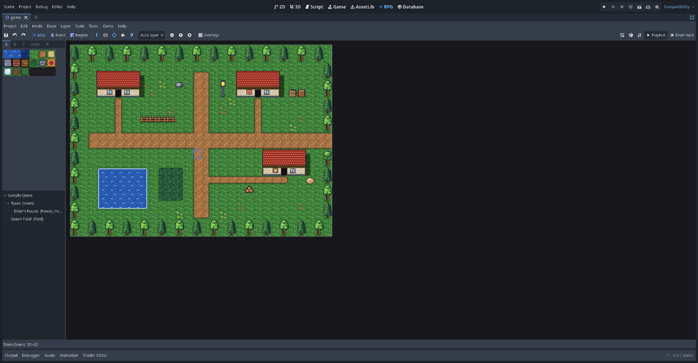
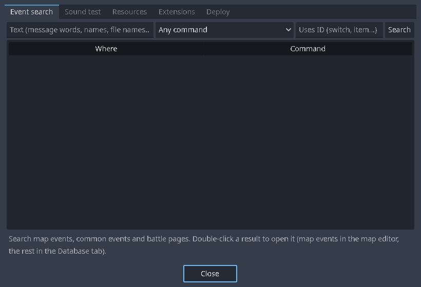
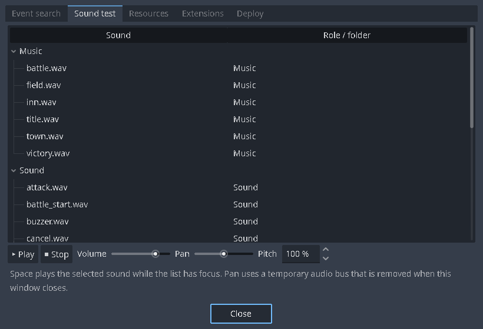
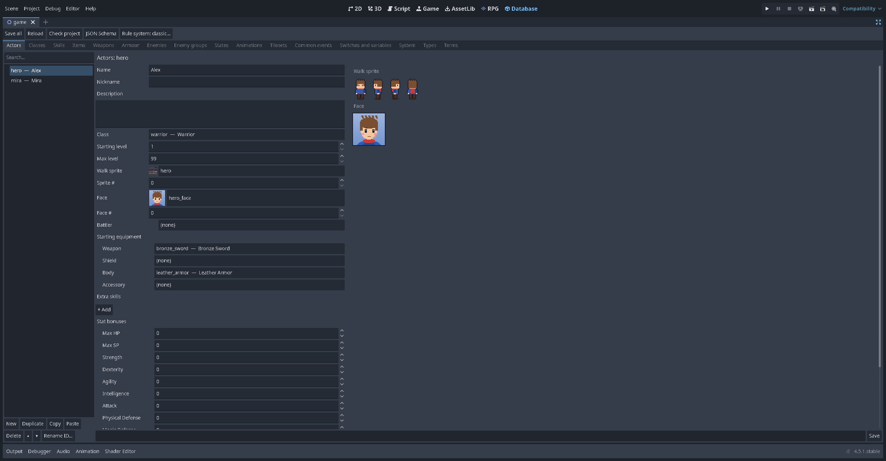

# A tour of the editor

The kit adds two tabs to the top of Godot's window: **RPG** (maps and events) and **Database** (everything else). While you are on either one, **Maker view** hides Godot's own docks, so the screen looks like RPG Maker's window. Turn it off in *Project > Maker view* on the RPG tab if you want Godot's docks back.

## The RPG tab

From top to bottom:

- **Menu bar:** Project, Edit, Mode, Draw, Layer, Scale, Tools, Game, Help.
- **Toolbar:**
  - Save, Undo, Redo.
  - Modes: **Map** (F5) for painting, **Event** (F6) for events, **Region** (F7) for region numbers, and **Navigation** (Shift+F7) for where characters can walk on an [image-backed map](Image-Backed-Maps.md).
  - Drawing tools: Pencil, Rectangle, Ellipse, Fill, Shadow pen.
  - **Auto layer** puts each tile on the right layer for you. Choose *Layer 1–4* to edit one layer on its own.
  - Zoom out, 1:1, zoom in.
  - **Overlays:** the grid, passability, regions and terrain tags.
  - On the right: **Tiles** (passability and flags for the map's tileset), **Database**, **Tools**, **▶ Playtest** and **From here** (click it, then the tile to start on).
- **Left column:** the **tile palette**, and under it the **map tree**.
  - Palette tabs for 2000/2003 tilesets: A, B, C and Anim. For VX/Ace/MV tilesets: A, A5, B, C, D and E. **R** holds region numbers.
  - Right-click the map tree for *New map…*, *Properties…*, *Copy*, *Paste*, *Delete*, favourites, *Set as starting map*, *Shift contents…*, *Generate dungeon…* and *Load sample map…*.
- **The map** fills the rest. The status bar under it shows the map's name and size.

### Keys worth knowing

| Key | What it does |
| --- | --- |
| F5 / F6 / F7 | Map / Event / Region mode |
| Shift+F7 | Navigation mode ([image-backed maps](Image-Backed-Maps.md)) |
| F8 | Open the Database |
| F9 or Ctrl+R | Playtest |
| Ctrl+Z / Ctrl+Y | Undo / redo (Godot's own history, also across map switches) |
| Ctrl+S | Save the map |
| Ctrl+= / Ctrl+− / Ctrl+0 | Zoom in / out / 1:1 |
| Right-click a tile (Map mode) | Pick up that tile (eyedropper) |
| Double-click (Event mode) | Create or edit an event |

### The Tools window

*Tools* on the menu bar opens a window with five pages:

| Page | What it does |
| --- | --- |
| **Event search** | Finds events by text, command type or the ID they use (a switch, an item…), page conditions included. Double-click a result to open it. |
| **Sound test** | Plays music and sounds, with volume and pitch. |
| **Resources** | Asset packs and their licences, which files the project uses, the MIDI sound bank, and **Import an RPG Maker project or RTP folder…** |
| **Extensions** | Turns extensions and the kit's plugins on or off, edits their settings, and creates new custom commands. |
| **Deploy** | The export checks. Double-click a problem to jump to it. |

The *Help* menu has the **Maker guide** (your first game in 15 minutes) and the page on following the RPG Maker tutorials. *Project > Open the rpg/ folder* opens your game's data folder.

| Event search | Sound test |
| --- | --- |
|  |  |

## The Database tab

The tabs along the top are: Actors, Classes, Skills, Items, Weapons, Armour, Enemies, Enemy groups, States, Animations, Tilesets, Common events, Switches and variables, System, Types and Terms. Plugins can add tabs of their own (the quest journal adds *Quests*).

- The list on the left has a search box. **New**, **Duplicate**, **Copy**, **Paste**, **Delete**, the arrows to reorder, and **Rename ID…** sit under it.
- Records have **IDs that are names**, like `potion` or `bronze_sword`, not numbers. Renaming an ID updates every place that uses it. Deleting a record retires its ID, so it is never reused by accident.
- On the right are the record's fields, with a preview of its graphics.
- Across the top: **Save all**, **Reload**, **Check project**, **JSON Schema** (for editing event files in VS Code) and **Rule system…**

## Safety nets

- Every file is written safely (to a temporary file first). If Godot stops in the middle of a save, the editor offers to recover the next time it starts.
- If a map's files change outside the editor (git, a text editor), the editor reloads them, or asks which version wins when you have unsaved changes.
- The RPG and Database tabs each re-read changed files when you switch to them, so they don't overwrite each other.

Next: [Lesson 1: Your first map](Lesson-1-Your-First-Map.md).
