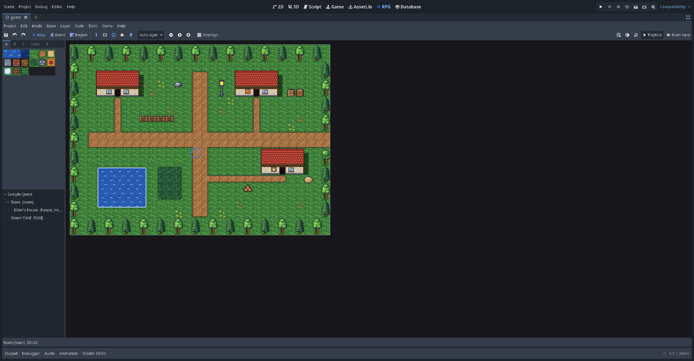
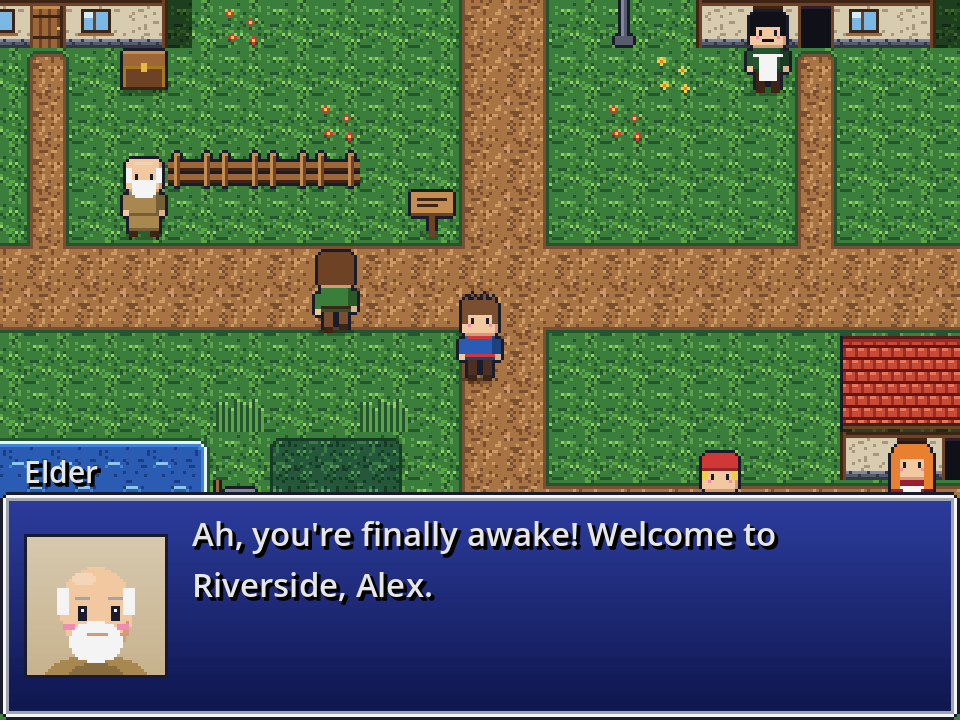
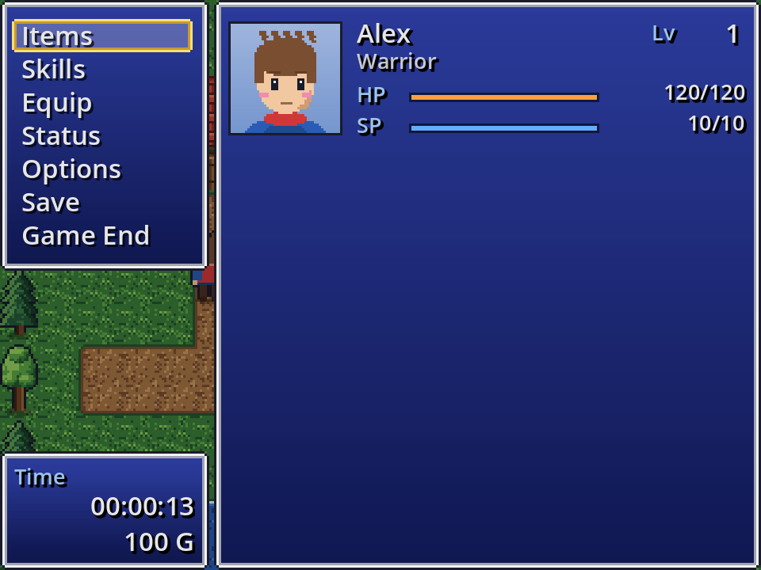

# rpgodot_mkr wiki

**rpgodot_mkr** (RPG Kit) puts an RPG Maker style workflow inside **Godot 4.5**. You paint maps with autotiles, build events with forms, fill a database and press Playtest. The kit supplies the message box, menus, shops, saves and battles, and you can replace each of them with ordinary Godot scenes when you outgrow them.

| What you'll make | |
| --- | --- |
|  |  |

## Start here

1. **[Installation](Installation.md)**: get Godot, get the kit, and open the sample game or start your own.
2. **[A tour of the editor](A-Tour-of-the-Editor.md)**: the RPG and Database tabs, and the keys worth knowing.
3. The **lessons**. Each one builds on the last, and together they make a small game:

| Lesson | You will learn |
| --- | --- |
| [1. Your first map](Lesson-1-Your-First-Map.md) | New maps, tiles and autotiles, layers, shadows, passability, regions |
| [2. Events and dialogue](Lesson-2-Events-and-Dialogue.md) | The event editor, pages, triggers, graphics, Show Text, choices |
| [3. Doors, chests, inns and shops](Lesson-3-Doors-Chests-Inns-and-Shops.md) | Quick events, transfers, self switches |
| [4. Switches, variables and story](Lesson-4-Switches-Variables-and-Story.md) | Page conditions, Conditional Branch, a small fetch quest |
| [5. Cutscenes and common events](Lesson-5-Cutscenes-and-Common-Events.md) | Autorun and parallel events, move routes, screen effects, common events |
| [6. The database](Lesson-6-The-Database.md) | Actors, classes, skills, items, equipment, states, system settings |
| [7. Battles](Lesson-7-Battles.md) | Enemies, enemy groups, encounters, battle events, front/side view, turn/ATB/CTB |
| [8. Playtest, debug and share](Lesson-8-Playtest-Debug-and-Share.md) | The debug screen, the export checks, building a game for players |
| [Image-backed maps](Image-Backed-Maps.md) | A map drawn as one picture in a paint program ("parallax mapping"): navigation, a foreground to walk behind, events |

## Reference

- [Coming from RPG Maker](Coming-from-RPG-Maker.md): where RPG Maker's menus, tabs and commands are in the kit.
- [Importing RPG Maker resources](Importing-RPG-Maker-Resources.md): bring in art and sound from RPG Maker 2000/2003, XP, VX/Ace and MV/MZ folders you own.
- [MIDI music](MIDI-Music.md): how `.mid` songs become audio, and choosing a sound bank.
- [Plugins](Plugins.md): the twelve kit plugins (quests, lighting, crafting, bestiary and more).
- [Event command reference](Event-Command-Reference.md): every built-in command.
- [Message codes](Message-Codes.md): `\V[...]`, `\N[...]`, colours, icons, waits.
- [Rule systems](Rule-Systems.md): Classic, VX Ace style and OSR stats and formulas.
- [Project files and git](Project-Files-and-Git.md): what is in `rpg/` and why it diffs cleanly.
- [For programmers](For-Programmers.md): the `RPG` autoload, custom commands, extensions, battle hooks, replacing screens.
- [Testing the kit](Testing-the-Kit.md): the test suites and helper scripts, for contributors.
- [Troubleshooting and FAQ](Troubleshooting-and-FAQ.md)
- [Limitations](Limitations.md): what is not done or not verified yet.

## Licence

Code is MIT. The generated starter art, icons and sounds in `assets/starter/` are CC0. The repository contains **no RPG Maker files**; the importer copies files you own into your own project, and those files stay under RPG Maker's licence.

*The lesson format follows the step-by-step style of the official RPG Maker beginner tutorials. The text and pictures here are our own.*
