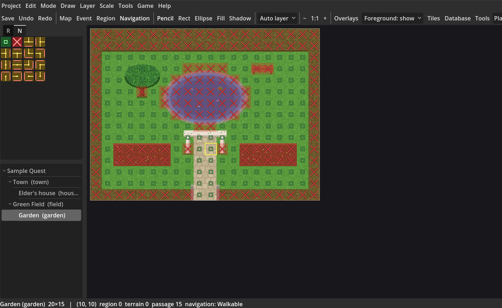
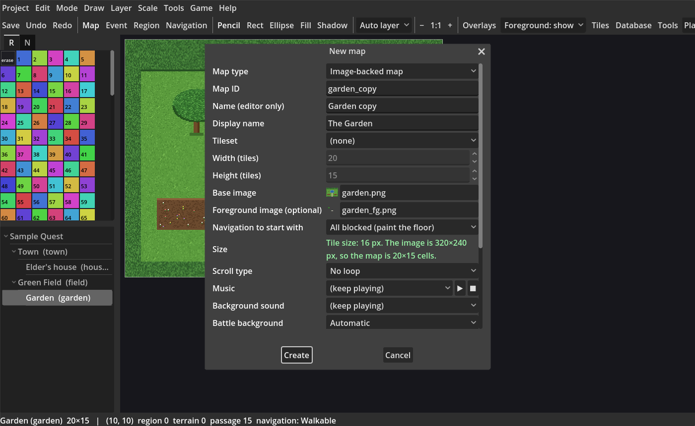
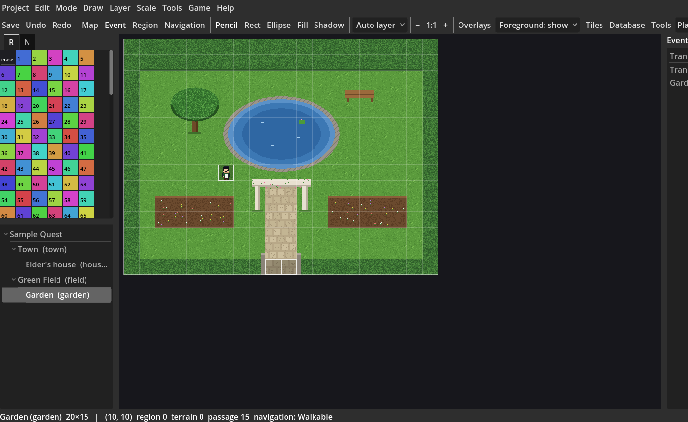
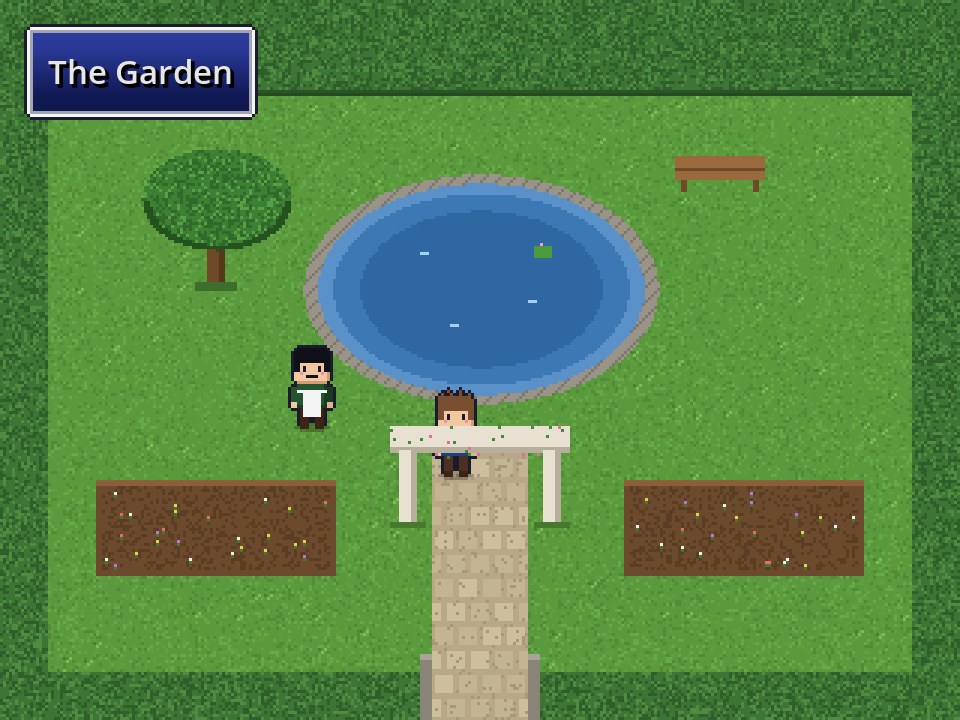

# Image-backed maps

Some makers draw a whole room or garden in a paint program (Aseprite, Krita, Photoshop) instead of building it from tiles. RPG Maker users call this *parallax mapping*. An **image-backed map** uses that picture as the map: you paint where characters can walk, then add events in Event mode as usual. You never open Godot's 2D editor.

In this lesson you make a small garden from the kit's sample picture, paint where the player can walk, add a gate back to town and a gardener who talks, and walk behind an arch.

*You need:* the kit installed and a project open ([Installation](Installation.md)). The sample pictures are `assets/starter/MapImage/garden.png` and `garden_fg.png`.

## The parts of an image-backed map

| Part | What it is | Who sees it |
| --- | --- | --- |
| **Base image** | The picture of the map. It is drawn under everything. | Players and you |
| **Foreground image** | Optional. A transparent picture the same size, drawn *over* the characters: wall tops, tree crowns, arches, door frames. | Players and you (you can dim or hide it while editing) |
| **Navigation** | Where characters can walk, painted cell by cell. | Only you, as an overlay |
| **Tiles** | Ordinary tile layers still work on top: animated water, a chest, a fix-up. Optional. | Players and you |
| **Regions** | Numbers you paint for encounters and events, as on any map. | Only you |
| **Parallax background** | A *different* feature: a picture behind the map that scrolls at its own speed and can loop (skies, seas). An image-backed map's picture is fixed to the map instead. | Players |

## Preparing the picture

- One **cell** is one tile of your project: 16×16 px in a 2000/2003-style project, 32×32 for XP/VX/VX Ace, 48×48 for MV/MZ. The New map dialog shows your project's tile size.
- The picture's width and height must be **whole numbers of cells**. 320×240 px is 20×15 cells at 16 px. If yours is 330×240, the kit tells you to make it 320 or 336 px wide. It never stretches, crops or pads your picture: change the canvas size in your paint program (not the image size, which would blur it).
- Draw at **1×**, one picture pixel per screen pixel of the game before the game's own scaling. The kit draws it sharp (no smoothing).
- Save as **PNG**. The foreground must be exactly the same size as the base, with transparent pixels wherever the base should show.
- The largest side allowed is 8192 px, and the editor warns above 4096 px. A picture takes width × height × 4 bytes of video memory once loaded (a 4096×4096 picture is 64 MB), however small the PNG file is. Split a big area into several maps joined by transfers.

Put the pictures in your project with **Tools > Resources > Import...**, asset type **Map image (image-backed maps)**. They go to `assets/project/MapImage/`.

## 1. Create the map

1. On the **RPG** tab, right-click the project's name in the map tree and choose **New image-backed map...** (or choose **New map...** and set **Map type** to *Image-backed map*).
2. **Base image**: click it and pick `garden`. The **Size** line shows the tile size and the map size it makes: *The image is 320×240 px, so the map is 20×15 cells.* Width and height are filled in for you.
3. **Foreground image (optional)**: pick `garden_fg`.
4. **Navigation to start with**: *All blocked (paint the floor)* suits a room with a small floor. Choose *All walkable (paint the walls)* for an open field.
5. Fill in **Map ID** (`garden`) and **Display name** (`The Garden`). **Tileset** can stay *(none)*; pick one if you want to add tiles later.
6. Press **Create**.

If the picture doesn't fit the grid, the dialog says why in red and keeps your typing, and nothing is written until you fix it.

The new map opens in **Navigation** mode.

## 2. Paint where characters can walk

Navigation mode (**Shift+F7**, or **Navigation** on the toolbar) shows the navigation over the picture:

| Mark | Meaning |
| --- | --- |
| Red tint with a cross | Blocked |
| Small open square | Walkable |
| Amber tint, lines towards some sides, bars across the others | Can only be entered and left through the sides with lines (a one-way ledge, a counter) |

The palette's **N** tab holds the brushes: *walkable*, *blocked*, then every one-sided combination. The usual tools work: **Pencil**, **Rectangle**, **Ellipse** and **Fill**, right-click to pick up a cell's value, **Ctrl+Z** to undo.

For the garden:

1. Pick *walkable* and drag **Rectangle**s over the lawn and the path.
2. Pick *blocked* and paint the hedges, the pond, the bench, the tree trunk and the two arch posts.
3. Leave the gate (the gap in the bottom hedge) walkable.

The navigation is saved with the map, separately from the pictures. Characters walk on it even where no tile is painted. If you do paint a tile on top (a fence), that tile can block too; it can never open a cell the navigation blocks.

To see the navigation in other modes, tick **Overlays > Navigation (image-backed maps)**.

## 3. A gate back to town, and a gardener

Switch to **Event** mode (F6). The grid lines up with the picture from the first cell to the last.

1. **The gate**: right-click the gate cell in the bottom hedge and choose **Quick events > Transfer**. For the destination press **Pick on map…**, open the town and click a tile. The picker shows every map as it looks, pictures included.
2. **The gardener**: double-click a lawn cell to make an event. Give it a character graphic, set the trigger to *Action button*, and add **Show Text**: *"Mind the roses!"*. See [Lesson 2](Lesson-2-Events-and-Dialogue.md) if you need a refresher.
3. Back in town, add a transfer into the garden (Quick events > Transfer, destination: the cell just inside the gate).

Everything from the other lessons works here: pages and conditions, autorun cutscenes, move routes (their preview is drawn over the picture), regions and encounters, **Playtest from here**.

## 4. Walk behind the arch

Press **▶ Playtest** (F9), go through the gate and walk up the path. The arch's beam and the tree's crown are in the foreground picture, so the hero walks *behind* them.

While editing, the toolbar's **Foreground: show / dim / hide** box lets you see under the foreground. It changes only the editor; the game always draws the foreground in full. Events stay visible and clickable either way.

## Changing the picture later

- **Same size**: save over the PNG in your paint program. When you come back to Godot, the map shows the new picture. Navigation, regions, tiles and events don't change.
- **A different picture of the same size**: right-click the map, **Properties...**, pick another **Base image** or **Foreground image**. To remove the foreground, set it to *(none)*; nothing else changes.
- **A different size**: the kit shows a review before changing anything. A bigger picture makes the map bigger (the new cells start blocked, or walkable if you started the map walkable). A smaller one lists everything that would be cut off (events, painted regions and navigation, starting positions) and only deletes them if you press **Resize and delete these**. Starting positions are moved inside instead. **Cancel** leaves the map and its pictures as they were. This change can't be undone.

## Checks before playtest and export

The checks that run before **Playtest** and **Tools > Deploy** stop with a clear message if a map's picture is missing or unreadable, isn't a whole number of cells, is too big, has a foreground of another size, or no longer matches the map's size. They name the map and the file. **Leave out unused assets** keeps every picture an image-backed map uses.

## What it doesn't do

- It doesn't work out where walls are from the picture: you paint the navigation.
- It doesn't turn a picture into a tileset, or split tall objects into base and foreground for you.
- There is no in-game decoration or furniture editor, no polygon or physics collision, no picture swaps for seasons or repairs (use a [Show Picture](Event-Command-Reference.md) or a tile layer), and no streaming of huge pictures. Split big areas into several maps.
- **Shift contents** is not available on image-backed maps, because the picture can't move with the tiles and events.

## Troubleshooting

| Problem | Fix |
| --- | --- |
| *The image is … not a whole number of … px tiles* | Change the canvas size (not the image size) to one of the sizes the message suggests. |
| The picture looks blurred | It was resized in the paint program. Draw at 1× and change only the canvas. The kit itself never smooths it. |
| Events sit one cell off the art | The picture has padding or was drawn on a different grid. Turn on **Overlays > Grid** and check that the grid lines fall where your art's cells do. |
| *Base image … does not exist* | The file was moved or renamed. Pick it again in **Properties...**. |
| The hero is drawn over a wall top | The wall top isn't in the foreground picture. Copy those pixels into the foreground, leave the rest transparent, and keep the canvas the same size. |
| The hero is hidden in the open | Something in the foreground picture isn't transparent there. |
| The hero walks through a wall | Paint those cells *blocked* in Navigation mode. |

Next: [Lesson 8: Playtest, debug and share](Lesson-8-Playtest-Debug-and-Share.md) covers building the game for players.
