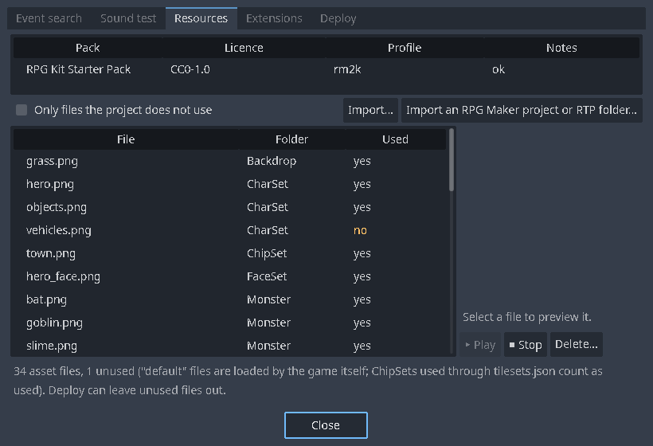
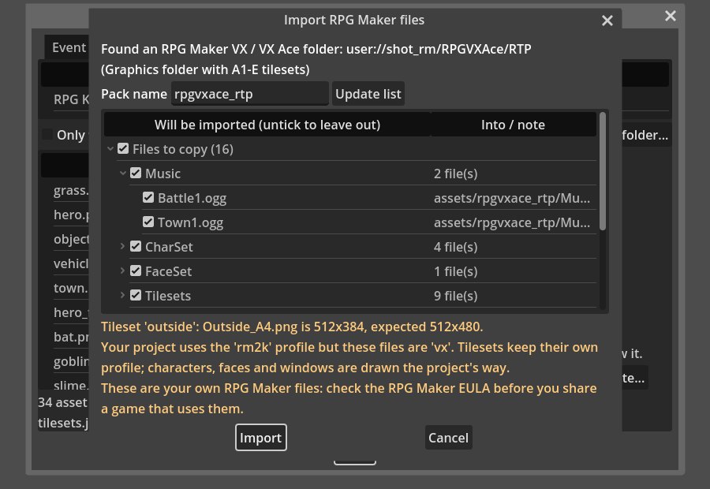

# Importing RPG Maker resources

If you own RPG Maker, you can bring its art and sound into a kit project: from an **RTP** (the art and sound package that comes with RPG Maker) or from an RPG Maker **project** folder. The kit never downloads or bundles RPG Maker files; it copies files from a folder on your own disk into your project.

> **Licence.** Imported files stay under RPG Maker's licence (EULA). Check it before you publish a game that uses them. The kit's repository contains no RPG Maker files.

## Supported makers

| Maker | Detected by | Tilesets made |
| --- | --- | --- |
| RPG Maker 2000 / 2003 | `ChipSet`, `CharSet`, `FaceSet` or `Monster` folders at the top | One per ChipSet file (A, B, C and Anim palette tabs) |
| RPG Maker XP | `Graphics/` with `Autotiles` or `Windowskins`, or 256 px wide tilesets | A project: one per tileset in `Data/Tilesets.rxdata`, with its name, its seven autotiles, and its passability, priorities and terrain tags. An RTP has no database: one per tileset file, with autotiles paired only where the file names make it clear (reported as guesses) |
| RPG Maker VX / VX Ace | `Graphics/` otherwise | One per name prefix: `Outside_A1` … `Outside_E` become the tileset `outside` |
| RPG Maker MV / MZ | an `img/` folder | RPG Maker's own tilesets, names and passability from `data/Tilesets.json` |

The importer has been run on the official 2000, 2003, XP and VX Ace RTPs and on real MV projects. MZ has not been tried on real files.

## Importing



1. Open **Tools > Resources** and press **Import an RPG Maker project or RTP folder…**
2. Choose the folder: the RTP's folder, or a project's folder. Choosing its `Graphics` or `img` folder works too; its parent is used, so the audio comes along.
3. The importer shows a **plan** before it writes anything: what kind of folder it found, the files it will copy (untick any you don't want), the tilesets it will create, what it skips and why, and anything it had to guess. You can change the **Pack name**, the folder the files go into.

   

4. Press **Import**. Files go to `assets/<pack>/…`, in the kit's folder names (CharSet, FaceSet, Monster, Music, Sound, …), and the pack shows on the Resources page with its licence.

## What is converted

- **BMP and JPG** images are converted to PNG.
- **2000/2003 transparency**: RPG Maker draws palette colour 0 as transparent in character sets, chip sets, face sets, monsters, system graphics and pictures. The importer writes that transparency into the copies, so they don't show a background box.
- **Character and face sheets** are cut the way the maker cuts them: 2000/2003 CharSets, XP single-character sheets, VX/MV 8-character sheets and `$` single-character sheets, 96 and 144 px faces.
- **Window skins**: 2000/2003 System graphics, XP Windowskins and VX/MV Window.png.
- **Side-view battlers**: 2003 BattleCharSets and MV/MZ `sv_actors` go to `BattleCharSet/`, for the side-view battle.
- **Game over** pictures go to `GameOver/`.
- **MIDI** music is copied and rendered to audio when Godot imports it (see [MIDI music](MIDI-Music.md)). A MIDI file that can't be read is skipped, with the reason.

## Tiles

- **2000/2003**: the ChipSet's autotiles (water, deep water, ground) are decoded, including the animated water and the blend pieces where deep and shallow water meet.
- **XP**: the seven autotiles of each tileset, plus the 8-column tile sheet.
- **VX / VX Ace / MV / MZ**: A1 (animated water and decorations), A2 (ground), A3 (buildings), A4 (walls), A5 and B–E. Deep sea, A1 decorations and see-through A2 tiles (bushes, forests, holes) are drawn over a hidden base layer, as RPG Maker layers them.
- **Passability**: MV/MZ read `data/Tilesets.json`; XP projects read `Data/Tilesets.rxdata`. VX and VX Ace keep their tileset settings in a binary database the kit doesn't read, so their tiles start with guessed settings. Check them with **Tiles** on the RPG tab ([Lesson 1](Lesson-1-Your-First-Map.md)). Your changes are kept in `rpg/tileset_overrides/` and survive a re-import.

## What is skipped

Folders the kit has no place for are listed with the reason, for example battle animation sheets, side-view enemies and second battle backgrounds. Encrypted files (MV/MZ `.rpgmvp`, `.rpgmvo`) and XYZ images are skipped too. RPG Maker's maps, events and database (`.lmu`, `.ldb`, `.rvdata2`, …) are **not** converted; the importer brings art and sound only.

## Using imported art

- Tilesets appear on **Database > Tilesets** and in each map's **Properties**.
- Characters, faces, monsters, pictures, music and sounds appear in every picker.
- The project's **Style** (set when it was created) decides the screen size. For VX and VX Ace tutorials, use the *VX / VX Ace* style.
- A different icon sheet laid out like RPG Maker's IconSet can be chosen in *Database > System > Icon sheet*; icon numbers then match that sheet.

## Checking a folder without importing

For contributors: `tools/rm_real_import_check.gd` imports a folder you own into `user://rm_real_check` (not into the project), builds every tileset and renders a contact sheet.

```bash
godot --headless --path . --script res://tools/rm_real_import_check.gd -- --folder="C:/path/to/RTP"
```
