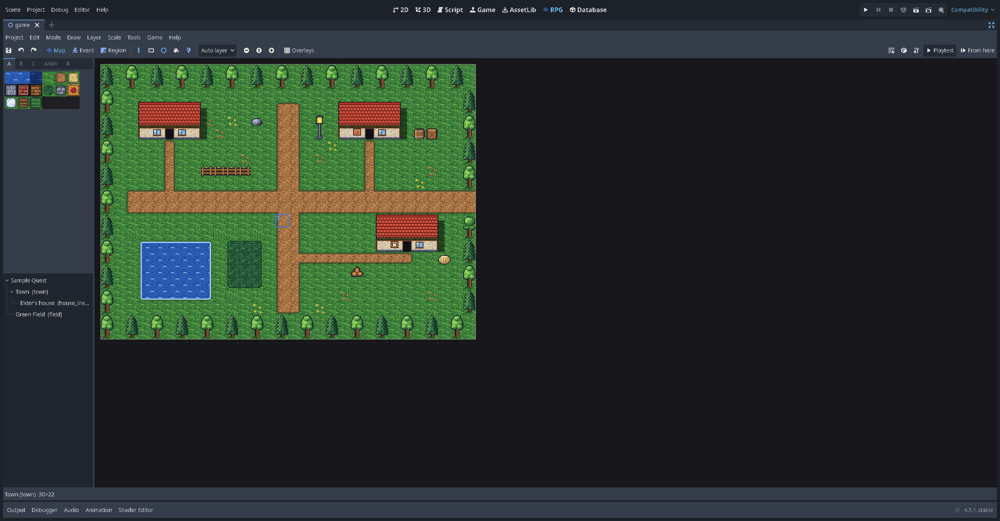
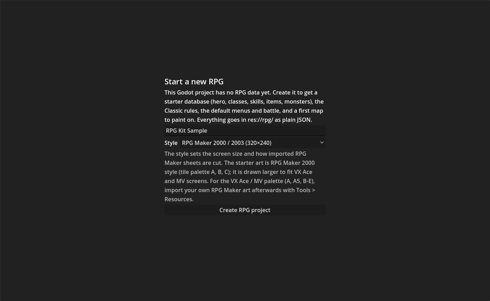
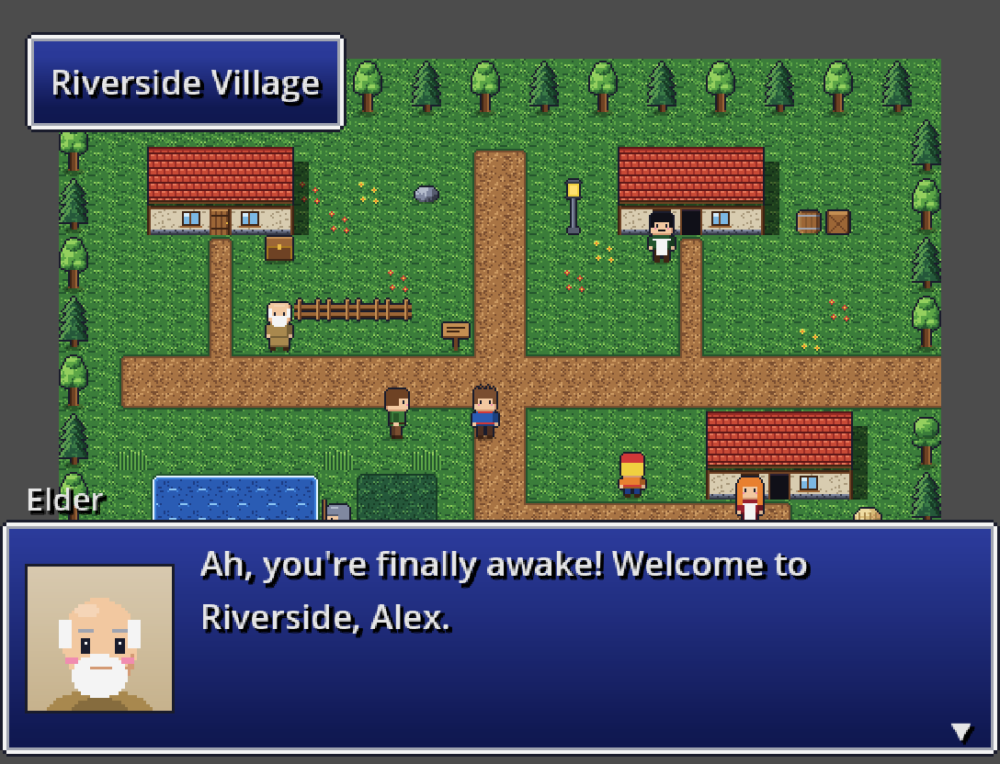

# Installation

You need two things: **Godot 4.5.1** and the **kit**. Nothing else is needed: the kit is pure GDScript, with no extra modules, plugins or programs to install.

## 1. Get Godot

1. Download Godot **4.5.1** from <https://godotengine.org/download>. The standard build is enough. The .NET build works too, but the kit doesn't use C#.
2. Unzip it anywhere. Godot doesn't need installing; the `.exe` (Windows), `.app` (macOS) or binary (Linux) runs as it is.

Older versions of Godot are not tested. The test runner uses the `Logger` API added in 4.5.

## 2. Get the kit

Either clone the repository:

```bash
git clone https://github.com/barnstorm/rpgodot_mkr.git
```

or, on the repository's GitHub page, press **Code > Download ZIP** and unzip it.

The folder you get is both the kit and a small sample game, *Sample Quest*:

| Folder | What it is |
| --- | --- |
| `addons/rpg/` | The kit: the runtime, the RPG tab and its editors, importers, plugins |
| `addons/rpg_database/` | The Database tab |
| `assets/starter/` | The starter art and sounds (CC0, generated by the kit's own scripts) |
| `rpg/` | The sample game's data: maps, events, database, rules |
| `extensions/project/` | The sample game's own custom command |
| `scenes/` | A fishing minigame, as an example of a custom scene |
| `tests/`, `tools/`, `docs/` | Tests, helper scripts and documentation; never part of an exported game |

## 3a. Open the sample game

1. Start Godot. In the Project Manager press **Import**, choose the `project.godot` file in the folder you got, and press **Import & Edit**.
2. The first time, Godot imports every image and sound. This takes a minute or so.
3. The **RPG** and **Database** tabs appear at the top, next to *2D*, *3D*, *Script* and *AssetLib*.
4. Press **▶ Playtest** (top right of the RPG tab), or **F9**, and play *Sample Quest*.

If the RPG tab is missing, open *Project > Project Settings > Plugins* and tick **RPG Kit**. It turns the Database plugin on by itself.



## 3b. Start your own game

To make your own game, put the kit into a new Godot project:

1. In the Project Manager press **Create**, pick an empty folder, and create the project. The renderer doesn't matter much for 2D; the sample uses *Compatibility*.
2. Close Godot. Copy these folders from the kit into your project folder, keeping their paths:
   - `addons/rpg/`
   - `addons/rpg_database/`
   - `assets/starter/` (the starter art and sounds; leave it out if you will import your own)
3. Open the project again. In *Project > Project Settings > Plugins*, tick **RPG Kit**. This adds the `RPG` autoload and turns on the Database tab.
4. Click the **RPG** tab. It says *Start a new RPG*:

   

5. Type your game's name and choose a **Style**:

   | Style | Game screen | Like |
   | --- | --- | --- |
   | RPG Maker 2000 / 2003 | 320×240 | RPG Maker 2000 and 2003 |
   | RPG Maker VX / VX Ace | 544×416 | RPG Maker VX and VX Ace |
   | RPG Maker MV | 816×624 | RPG Maker MV and MZ |

   

   The style sets the screen size, the window size (2–3× larger for the small screens), and how imported RPG Maker sheets are cut. The starter art is 2000-style (16 px tiles, palette tabs A, B, C), in every style; in VX and MV projects it is drawn larger to fit. The palette follows each tileset, so imported VX/MV tilesets show RPG Maker's A, A5, B–E tabs.

6. Press **Create RPG project**. The kit writes a starter database (a hero, classes, skills, items, monsters), the *Classic* rule system, and a first map into `res://rpg/`. If the project has no main scene yet, it sets the kit's game scene as the main scene, so Playtest works at once.

Now go on to [A tour of the editor](A-Tour-of-the-Editor.md), or straight to [Lesson 1](Lesson-1-Your-First-Map.md).

## Linux and macOS

The kit runs the same on every system Godot runs on. One thing differs: **MIDI music**. On Windows, `.mid` files are rendered with Windows' own `gm.dls` sound bank by default; elsewhere they use the kit's built-in instruments. To make every computer produce the same music, use a soundfont file and copy it into the project (see [MIDI music](MIDI-Music.md)).

## Updating the kit

Your game lives in `rpg/` (and `assets/`, `extensions/`), never inside `addons/`. To update, close Godot, replace `addons/rpg/` and `addons/rpg_database/` with the new versions, and open the project again. Keep your project in git (or make a copy) before updating, so you can go back. Players' save files carry a version number and are migrated when they are loaded.

## Optional: run the tests

Contributors, or anyone who wants to check that everything works, can run the test suites. See [Testing the kit](Testing-the-Kit.md).
