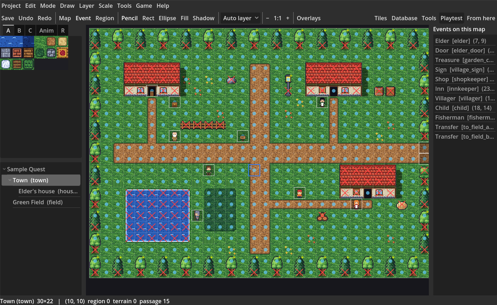
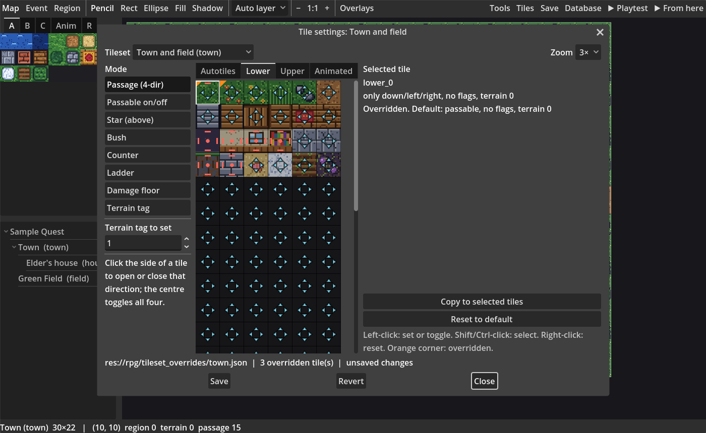
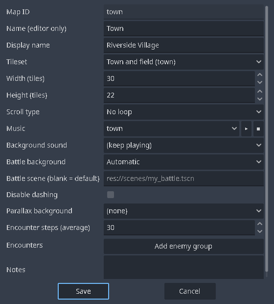

# Lesson 1: Your first map

In this lesson you make a small village map: grass, a path, a pond, some trees and a house. You will learn the tile palette, autotiles, layers, the drawing tools and passability.

*You need:* the kit installed, with the sample project or a project you created ([Installation](Installation.md)).

## 1. Make a new map

1. On the **RPG** tab, right-click the project's name at the top of the map tree and choose **New map…**
2. Fill in the form:
   - **Map ID**: a short name used inside the game, such as `village`. IDs are names, not numbers, and they never change by accident.
   - **Name (editor only)**: what the map tree shows, such as `My Village`.
   - **Display name**: what players see when they enter the map (leave it empty to show nothing).
   - **Tileset**: the starter project has *Town and field*.
   - **Width** and **Height**: try 25 × 18 tiles. You can change it later.
3. Press **OK**. The new map is empty and selected in the tree.

To put a map *inside* another one (a house inside a town, as in the sample's *Elder's house*), right-click the parent map and choose *New map…*. The tree is only for keeping things tidy; any map can lead to any other.

## 2. Paint the ground

The **tile palette** is on the left. Tab **A** holds the ground: grass, dirt, water, walls and floors.

1. Choose the **Fill** tool on the toolbar, click a grass tile in the palette, then click the map. The whole map becomes grass.
2. Choose the **Pencil**, click the dirt tile and draw a path across the map with the mouse held down.
3. Notice that the path's edges **join up by themselves**. These tiles are **autotiles**: each one picks the right edge and corner pieces from its neighbours.
4. Choose **Rectangle**, click the water tile and drag a box for a pond. Its shore is drawn for you.

Made a mistake? **Ctrl+Z** undoes, **Ctrl+Y** redoes. Right-click a tile on the map to pick it up into the palette (the eyedropper); right-drag to pick up an area. Hold **Shift** while painting to place an autotile *without* joining it to its neighbours.

**Ellipse** draws round shapes.

## 3. Add trees and a house

With the starter tileset (RPG Maker 2000 style), tab **B** holds more ground tiles and tab **C** holds things that stand *on* the ground: trees, fences, rocks, roofs, walls, doors, furniture.

1. Click a tree in tab **C** and click the map. The tree is placed *on top* of the grass; the grass stays underneath.
2. Drag across several tiles in the palette to pick a block (for example a whole house), then click the map to stamp it.

This works because of **layers**. A map has four. With **Auto layer** chosen on the toolbar, tabs A and B paint Layer 1 (the ground) and tab C paints Layer 2 (things on the ground), so you rarely need to think about it. To work on one layer only, pick *Layer 1–4* in the same box; the other layers are dimmed. Layers 3 and 4 are only used when you pick them.

To **erase** an object, paint with the first tile of tab C (the empty one): it is the eraser. **Fill** with the eraser clears an area.

With VX, VX Ace and MV tilesets (imported from RPG Maker you own) the palette has RPG Maker's tabs instead: A, A5, B, C, D and E, where B to E all stand on the ground and the first tile of B erases. Deep water, bushes and other see-through ground tiles are drawn over whatever ground is underneath, as RPG Maker does.

## 4. Shadows

The **Shadow** tool draws the soft shadow on the left of a building, a quarter tile at a time. Click and drag along a wall's lower side. The editor also draws shadows by itself next to walls you paint; hand-drawn ones are kept when you paint floor nearby.

## 5. Check where the player can walk

Open **Overlays** on the toolbar and tick **Passability**. Tiles the player can't walk on get a red cross. Fully walkable tiles show a dot; tiles that block only some directions show a line towards each side that is open.

Whether a tile can be walked on comes from the tileset's **tile settings**. Press **Tiles** on the toolbar to see and change them:

| Mode | What it sets |
| --- | --- |
| Passage (4-dir) | Which sides of the tile can be entered. Click a side to open or close it; the centre toggles all four. |
| Passable on/off | The whole tile at once. |
| Star (above) | The tile is drawn above the player (tree tops, roofs, arches). |
| Bush | The lower part of characters is hidden in it (tall grass). |
| Counter | The player can talk *across* it (shop counters). |
| Ladder | Characters climb it facing away. |
| Damage floor | Hurts the party each step (poison swamps, lava). The damage is set in *Database > System*. |
| Terrain tag | A number events can read with *Get Location Info*. |

Your changes are saved in `rpg/tileset_overrides/`, so they survive when the tileset is imported again. **Reset to default** undoes one tile.

## 6. Regions

Regions are numbers you paint on the map. Players never see them; they are for you. Use them to say "monsters A appear here, monsters B over there" (see [Lesson 7](Lesson-7-Battles.md)), or to check where the player is from an event.

1. Switch to **Region** mode (F7). The palette shows tab **R** with the numbers.
2. Pick a number and paint it like a tile.

## 7. Map properties

Right-click the map in the tree and choose **Properties…** to change:

- **Tileset**, **Width**, **Height**.
- **Scroll type**: whether the map wraps around (for world maps).
- **Music** and **Background sound**: a file, "(keep playing)" or "(stop)". The music starts when the player enters.
- **Battle background** and **Battle scene** (empty means the default battle).
- **Disable dashing**.
- **Parallax background**: a picture behind the map, for skies and seas.
- **Encounters**: the average number of steps between random battles, and the enemy groups that can appear (see [Lesson 7](Lesson-7-Battles.md)).
- **Notes**: your own notes.

## 8. Where does the player start?

The game starts on the **starting map**. Right-click your map in the tree and choose **Set as starting map**, or, in **Event** mode, right-click a tile and choose *Set starting position > Player*.

Press **▶ Playtest** (F9) and walk around your village. Try to walk into the pond and the trees.

## Try it yourself

- Right-click the map tree and choose **Generate dungeon…** to make a cave from rooms and corridors.
- **Load sample map…** copies one of the kit's sample maps into your project to study.
- **Shift contents…** moves the whole map's contents up, down, left or right by a number of tiles; what is pushed off one edge comes in at the other. This helps when you make a map bigger on its left or top side.

Next: [Lesson 2: Events and dialogue](Lesson-2-Events-and-Dialogue.md).
