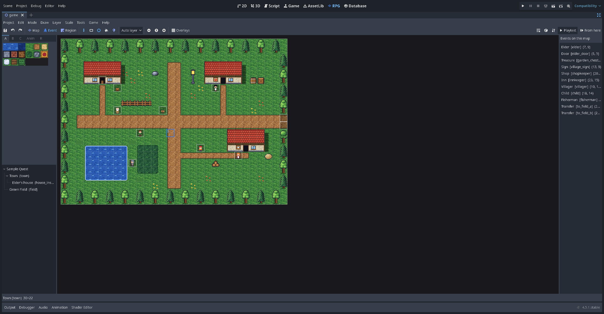
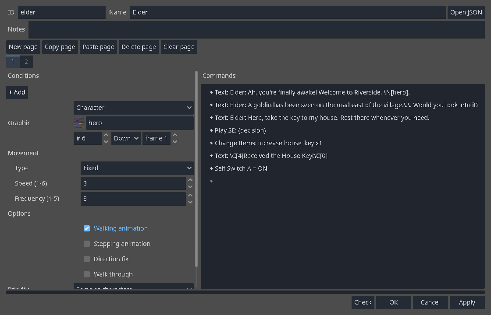
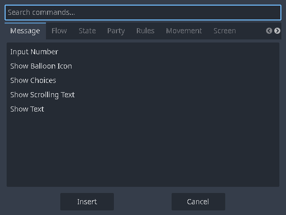
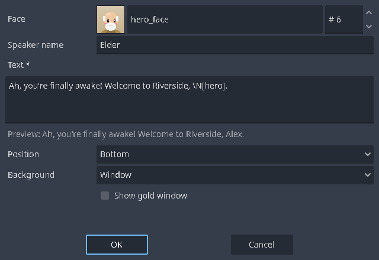

# Lesson 2: Events and dialogue

An **event** is anything on the map that does something: a villager who talks, a sign, a door, a chest, a trap, or an invisible trigger that starts a cutscene. In this lesson you put a villager in your village and make them talk, ask a question and react to the answer.

## 1. Event mode

Press **Event** on the toolbar (or F6). The grid appears, and every event on the map shows as a small box. The list on the right, *Events on this map*, shows each event's name, ID and position; click one to jump to it.



In Event mode:

- **Double-click** an empty tile to create an event, or an event to edit it.
- **Right-click** a tile for *New event…*, *Paste*, *Quick events* (next lesson), *Set starting position* and **▶ Playtest from here**.
- Right-click an event for *Edit…*, *Cut*, *Copy* and *Delete*. Drag an event to move it.

## 2. The event editor

Double-click an empty grass tile. The event editor opens:



- At the top: the event's **ID** (a name such as `villager`), its **Name** in the editor, and **Notes**. **Open JSON** shows the event's data for power users.
- The **pages** (1, 2, …) with *New page*, *Copy page*, *Paste page*, *Delete page* and *Clear page*. Pages come in Lesson 4; one is enough for now.
- **Left column**, the page's settings:
  - **Conditions**: when this page is active (Lesson 4).
  - **Graphic**: the character sheet, which character on it, the direction it faces and the frame. Choose *Tile* to show a tile of the tileset instead (a pot, a sign), or nothing for an invisible event.
  - **Movement**: *Fixed* (stands still), *Random*, *Approach the player* or *Custom route*, with a speed (1–6) and how often it moves (1–5).
  - **Options**: walking animation, stepping animation (moves its feet while standing), direction fix (never turns), walk through.
  - **Priority**: *Below characters* (the player walks over it, like a switch on the floor), *Same as characters* (it blocks like a person) or *Above characters*.
  - **Trigger**: how it starts:

  | Trigger | Starts when… |
  | --- | --- |
  | Action button | the player faces it and presses OK (Z, Enter, Space or a click) |
  | Player touch | the player walks into it |
  | Event touch | the player walks into it, or it walks into the player |
  | Autorun | at once, and again and again while the page is active; the player can't move meanwhile (cutscenes) |
  | Parallel | at once, in the background, over and over, while the player keeps moving |

- **Right column**, the **command list**: what the event does, from top to bottom.
- At the bottom: **Check** (looks for mistakes), **OK**, **Cancel**, **Apply**.

## 3. Make the villager talk

1. Set the **ID** to `villager`.
2. Click the **Graphic** box and choose a character. The starter `hero` sheet holds several people; the number next to it picks one.
3. Set **Movement** to *Random* so they wander, and leave the trigger on **Action button**.
4. In the command list, double-click the **◆** line. The **command picker** opens, with a tab per category and a search box:

   

5. Choose **Show Text** (category *message*). Its form opens:

   

   - **Face**: a face picture shown in the message box (optional).
   - **Speaker name**: shown in a small box above the message.
   - **Text**: what they say. Each line of the box is a line here.
   - **Position**: bottom, middle or top. **Background**: window, dim or transparent.

   Type `Lovely weather today, isn't it?` and press **OK**.

6. Press **OK** in the event editor, then **▶ Playtest from here** on a tile next to the villager (right-click the tile). Walk up, face them and press **Z**.

## 4. Ask a question

1. Open the villager again. Double-click the **◆** under the Show Text line and choose **Show Choices**.
2. The choices are *Yes* and *No* to begin with. Change them to `Yes` and `Not really`. Set *When cancelled* to *Last choice*, so pressing X answers "Not really".
3. Press **OK**. The list now has a branch for each choice, each with its own **◆** line:

   ```
   ◆ Text: Lovely weather today, isn't it?
   ◆ Show Choices: Yes, Not really
     When [Yes]
       ◆ Text: I knew you'd agree!
       ◆
     When [Not really]
       ◆ Text: Oh. Well, I like it.
       ◆
   ◆
   ```

4. Fill each branch with its own Show Text.

A choice can also be hidden, or greyed out, while a switch is OFF: use *Shown only while switch is ON* and *Can be picked only while switch is ON*. Switches come in Lesson 4.

## 5. Working with the command list

Right-click the list for *New*, *Edit*, *Cut*, *Copy*, *Paste*, *Delete*, *Select all*, *Copy as text*, **Test** (runs the selected commands in the game) and **Toggle skip** (Ctrl+/: keeps a line but doesn't run it). Shift-click selects several lines; drag lines to move them. A line with a mistake shows a warning sign.

## 6. Message codes

Messages can include codes that are replaced when the message is shown:

| Code | Shows |
| --- | --- |
| `\N[hero]` | the name of the actor with ID `hero` |
| `\V[coins]` | the value of the variable `coins` |
| `\G` | the currency name |
| `\C[2]` … `\C[0]` | text in colour 2, then back to normal |
| `\I[64]` | icon 64 of the icon sheet |
| `\.` and `\|` | a short (¼ s) or long (1 s) pause |

The full list is on [Message codes](Message-Codes.md).

## Try it yourself

- Add a **Show Balloon Icon** (an exclamation mark or a heart over the villager's head) before the text.
- Add **Play SE** to make a sound.
- Make a cat with *Random* movement, *Stepping animation* and the trigger **Player touch**, which says "Meow!" when you bump into it.

Next: [Lesson 3: Doors, chests, inns and shops](Lesson-3-Doors-Chests-Inns-and-Shops.md).
