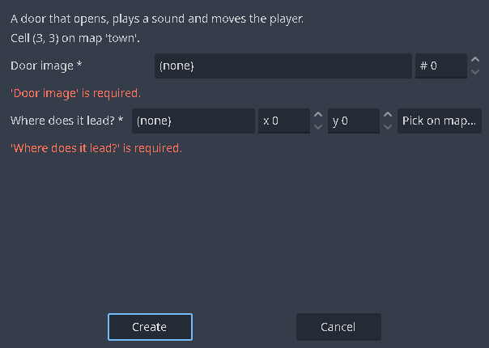

# Lesson 3: Doors, chests, inns and shops

Some events are needed in every RPG. **Quick events** build them for you from a few questions. In this lesson you add a house the player can enter, a treasure chest, an inn and a shop. Then you look inside the events they made, so you can build your own.

## 1. A room to go into

1. Right-click your village in the map tree and choose **New map…**. Call it `house`, *Name* `House`, size 13 × 10.
2. Paint a floor and walls with the indoor tiles of tabs **A** and **B**, and furniture from tab **C**.

## 2. A door

1. Go back to the village and switch to **Event** mode (F6).
2. Right-click the tile where the house's door is and choose **Quick events > Door**. The form asks two questions:

   

   - **Door image**: the door's graphic on a character sheet (the starter `objects` sheet has doors).
   - **Where does it lead?**: press **Pick on map…**. The form steps aside, the `house` map opens, and you click the tile inside the doorway. The map you were on comes back.

3. Press **Create**. The door opens with a sound and moves the player inside.

Questions marked `*` must be answered; the form says which are missing.

## 3. The way back

Inside the house, right-click the tile in front of the door and choose **Quick events > Transfer**. Pick the tile *outside* the village door as **Where to?**, and *Face which way?* `Down`. A Transfer is invisible and starts when the player steps on it.

Playtest: walk in and out.

## 4. A treasure chest

Right-click a tile inside the house and choose **Quick events > Treasure**:

- **Chest image**: the chest on the `objects` sheet.
- **What is inside?**: Gold, Item, Weapon or Armour.
- **Which one?** and **How many (or how much gold)?**

The chest opens once and stays open, even after saving and loading. How? Open the event (double-click it) and look at its two pages:

- **Page 1** has the closed chest. Its commands play a sound, open the lid, give the item, show a message and then turn **self switch A** ON.
- **Page 2** has the condition *Self switch A is ON* and the open chest graphic, and does nothing.

A **self switch** is an ON/OFF value that belongs to one event (each event has A, B, C and D). The game always uses the **last page whose conditions are all true**, so once A is ON, page 2 wins. You will use this trick for everything that should happen only once.

## 5. An inn

Right-click a tile behind a counter and choose **Quick events > Inn**: the innkeeper's image and the **price for one night**. The innkeeper asks whether the party wants to stay, takes the gold, fades the screen and heals everyone.

Place it *behind* a counter tile (one with the **Counter** flag in the tile settings): the player can talk to an event across a counter.

## 6. A shop

Right-click a tile and choose **Quick events > Shop**:

- **Shopkeeper image**.
- **Items for sale**: add rows of goods (an item, a weapon or an armour each).
- **Buy only**: tick it for a shop that doesn't buy things back.

The shop uses the prices from the Database; the **Shop Processing** command can set a different price per row.

## 7. A sign

**Quick events > Sign** asks **What does it say?**, an optional image, and **How is it read?**: *Examined* (face it and press OK) or *Stepped on*.

## 8. Doing it by hand

Quick events only write ordinary events. Everything they do, you can build with the event editor:

| Quick event | The commands inside |
| --- | --- |
| Door | Play SE, two **Set Move Route** commands (the door opens, the player steps in), **Transfer Player** |
| Transfer | Play SE, **Transfer Player** (Destination, Facing, Fade); trigger *Player touch* |
| Treasure | Play SE, a move route that opens the lid, **Change Items** (or gold), Show Text, **Control Self Switch** A = ON; a second page with the condition *Self switch A* |
| Inn | Show Text, **Show Choices**, a **Conditional Branch** on gold, then **Change Gold**, **Fade Out Screen**, Play ME, Wait, **Recover All**, **Fade In Screen** and Show Text (else "not enough gold") |
| Shop | Show Text, **Shop Processing** |
| Sign | **Show Text** |

**Transfer Player** has one more setting: *If occupied, use the nearest free cell within…* tiles, so a transfer never puts the player inside another character.

## Try it yourself

- Lock the house: make the door's first page say "It's locked." and give it a second page with an *Item* condition (the party holds a key) that opens it. The sample game does exactly this with the elder's house key.
- Put a chest with 100 gold in a corner and a Mimic in another (Lesson 7 shows how to start a battle from an event).

Next: [Lesson 4: Switches, variables and story](Lesson-4-Switches-Variables-and-Story.md).
