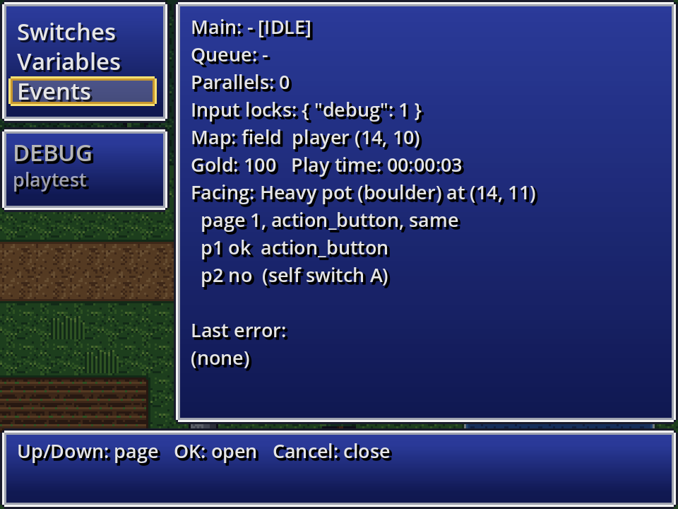

# Lesson 4: Switches, variables and story

A story needs memory: has the hero met the king? How many apples have they picked? In this lesson you build a small quest: a farmer asks for three apples, you pick them from trees around the village, and the farmer pays you when you return.

## The game's memory

| Name | Holds | Example |
| --- | --- | --- |
| **Switch** | ON or OFF, for the whole game | `farmer_quest_started` |
| **Variable** | a value for the whole game: usually a whole number, or a decimal, true/false or text (set on the Switches and variables tab) | `apples` |
| **Self switch** | ON or OFF (A, B, C, D) for one event | "this tree was picked" |

Switches and variables have **names**, not numbers: `talked_to_king`, not "Switch 0012". You create them on the Database's **Switches and variables** tab, or straight from any switch or variable field with **New…**: type the name and it exists.

Everything is saved with the game.

## 1. The farmer asks

1. Make an event `farmer`. For its graphic pick one of the people on the starter `hero` sheet (it holds several characters).
2. Page 1, trigger *Action button*:
   ```
   ◆ Text: Farmer: Could you bring me 3 apples from the trees around the village?
   ◆ Control Switch: farmer_quest_started = ON
   ```
   In the switch field, press **New…** and type `farmer_quest_started`.

## 2. Pages and conditions

An event can have several **pages**. Each page has **conditions**, and the game uses the **last page whose conditions are all true**. Pages with no conditions are always true.

Press **New page** in the farmer's event. Page 2 starts empty: give it the same graphic (or use *Copy page* and *Paste page* to start from page 1). Under **Conditions** press **+ Add** and choose *Switch* `farmer_quest_started` *is ON*:

```
Page 2   (condition: farmer_quest_started is ON)
◆ Text: Farmer: Any luck with those apples?
```

Now the farmer says the first line once, and the second line from then on.

Page conditions can be:

| Condition | True when… |
| --- | --- |
| Switch | a switch is ON (or OFF) |
| Variable | a variable compares with a value: =, ≠, <, ≤, >, ≥ |
| Self switch | one of this event's self switches is ON (or OFF) |
| Item / weapon / armour held | the party has at least N of it |
| Actor | an actor is in the party |

Plugins can add more: the quest journal adds *Quest*, lighting adds *Time of day*. **There is no limit** to the number of conditions on a page; all must be true.

## 3. Apple trees

Make an event on a tree (for its graphic, choose *Tile* and pick a tree tile, or leave it invisible on top of a painted tree), trigger *Action button*:

```
Page 1   (condition: farmer_quest_started is ON)
◆ Play SE: decision
◆ Control Variable: apples add 1
◆ Text: You picked an apple! (\V[apples] / 3)
◆ Control Self Switch: A = ON
Page 2   (condition: Self switch A is ON)
   (nothing: an empty tree)
```

Page 1's condition makes the trees useless before the quest begins; page 2 makes each tree give only one apple. Copy the event (right-click > *Copy*, then *Paste* on another tree) to make three trees. Each copy has its own self switches.

**Control Variable** can *set*, *add*, *subtract*, *multiply*, *divide* or take the remainder (*mod*). The value can be a **number**, another **variable**, a **random** number between two values, or **game data**: how many of an item the party holds, gold, steps, play time, party size, an actor's level, EXP or stats.

## 4. Conditional Branch: the farmer checks

Go back to the farmer's page 2 and replace its line:

```
Page 2   (condition: farmer_quest_started is ON)
◆ Conditional Branch: apples >= 3
  Then
    ◆ Text: Farmer: Wonderful! Here, take this.
    ◆ Change Gold: + 50
    ◆ Control Switch: farmer_quest_done = ON
  Else
    ◆ Text: Farmer: Any luck with those apples?
```

**Conditional Branch** (category *flow*) checks one condition and runs *Then* or *Else*. It has every page condition above, plus some only branches have: *Gold*, *Vehicle*, *Character facing* and *Button held down*.

Add page 3 with the condition `farmer_quest_done is ON` and the line "Thanks again!". Because page 3 is the last page that is true, it wins once the quest is done.

## 5. Show it on screen

Messages show variables and switches with codes: `\V[apples]` shows the number, `\S[farmer_quest_done]` shows ON or OFF. See [Message codes](Message-Codes.md).

## 6. Check your work

Playtest and press **F9** (playtest only) to open the **debug screen**: every switch and variable, which you can change on the spot. Its *Events* page shows the event in front of you, its pages, and **which condition keeps each page off**, which is the quickest way to find out why an event isn't doing what you expect.



On the editor side, **Tools > Event search** finds every event that uses a switch or variable (including in page conditions). Search for `farmer_quest_started` to see every place it is set or checked.

## Try it yourself

- Use a **Loop** with **Break Loop** to ask "How many apples will you sell? (Input Number)" until the answer is valid.
- Use **Label** and **Jump to Label** to repeat a shop keeper's question.
- Add a choice to the farmer that only appears while the party has a *Golden apple* (Show Choices' *Shown only while switch is ON*, with a switch you set when the golden apple is found).

Next: [Lesson 5: Cutscenes and common events](Lesson-5-Cutscenes-and-Common-Events.md).
