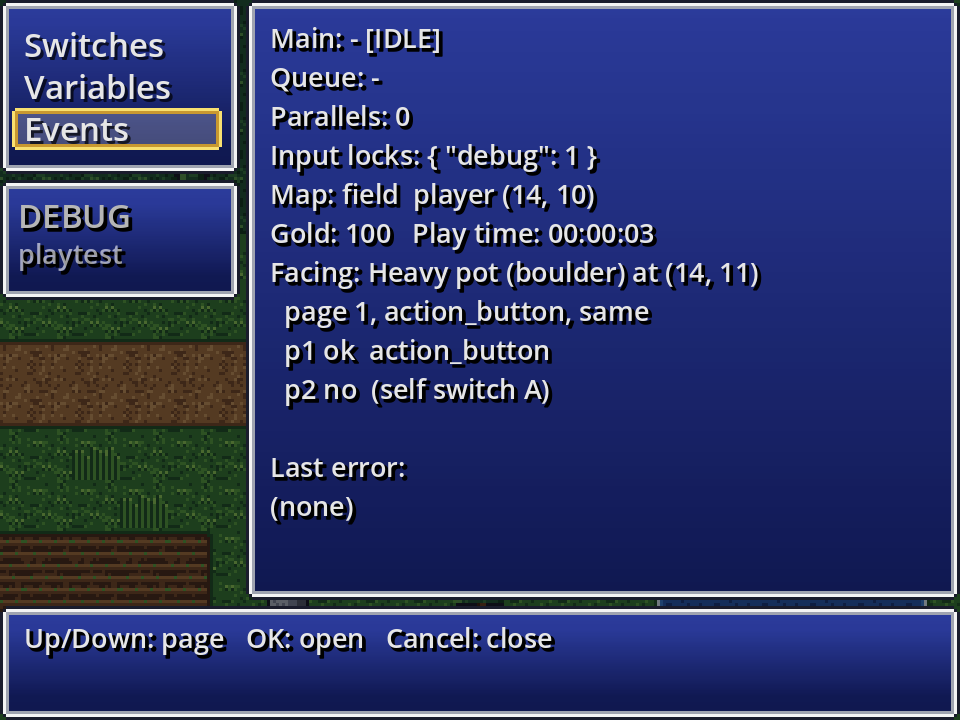

# Lesson 4: Switches, variables and story

A story needs memory: has the hero met the king? How many apples have they picked? In this lesson you build a small quest: a farmer asks for three apples, you pick them from trees around the village, and the farmer pays you when you return.

## The game's memory

| Name | Holds | Example |
| --- | --- | --- |
| **Switch** | ON or OFF, for the whole game | `farmer_quest_started` |
| **Variable** | a value for the whole game: usually a whole number, or a decimal, true/false or text (set on the Switches and variables tab) | `apples` |
| **Self switch** | ON or OFF (A, B, C, D) for one event | "this tree was picked" |
| **Self variable** | a named value (number, true/false or text) for one event | `times_opened` on this chest |

Switches and variables have **names**, not numbers: `talked_to_king`, not "Switch 0012". You create them on the Database's **Switches and variables** tab, or straight from any switch or variable field with **New…**: type the name and it exists.

Everything is saved with the game.

## 1. The farmer asks

1. Make an event `farmer`. For its graphic pick one of the people on the starter `hero` sheet (it holds several characters).
2. Page 1, trigger *Action button*:
   ```
   ◆ Text: Farmer: Could you bring me 3 apples from the trees around the village?
   ◆ Control Switch: farmer_quest_started = ON
   ```
   In the switch field, press **New…** and type `farmer_quest_started`.

## 2. Pages and conditions

An event can have several **pages**. Each page has **conditions**, and the game uses the **last page whose conditions are all true**. Pages with no conditions are always true.

Press **New page** in the farmer's event. Page 2 starts empty: give it the same graphic (or use *Copy page* and *Paste page* to start from page 1). Under **Conditions** press **+ Add** and choose *Switch* `farmer_quest_started` *is ON*:

```
Page 2   (condition: farmer_quest_started is ON)
◆ Text: Farmer: Any luck with those apples?
```

Now the farmer says the first line once, and the second line from then on.

Page conditions can be:

| Condition | True when… |
| --- | --- |
| Switch | a switch is ON (or OFF) |
| Variable | a variable compares with a value: =, ≠, <, ≤, >, ≥ |
| Self switch | one of this event's self switches is ON (or OFF) — or another event's, on any map |
| Self variable | one of this event's self variables compares with a value — or another event's, on any map |
| Item / weapon / armour held | the party has at least N of it |
| Actor | an actor is in the party — or a check on them: name, class, a skill learned, equipment, a state, their level, HP or SP (a value or a percentage of their max) |
| Formula | a formula (the [formula language](Rule-Systems.md), with the project's variables as `v.name`) is true or non-zero |

Plugins can add more: the quest journal adds *Quest*, lighting adds *Time of day*. **There is no limit** to the number of conditions on a page; all must be true.

## 3. Apple trees

Make an event on a tree (for its graphic, choose *Tile* and pick a tree tile, or leave it invisible on top of a painted tree), trigger *Action button*:

```
Page 1   (condition: farmer_quest_started is ON)
◆ Play SE: decision
◆ Control Variable: apples add 1
◆ Text: You picked an apple! (\V[apples] / 3)
◆ Control Self Switch: A = ON
Page 2   (condition: Self switch A is ON)
   (nothing: an empty tree)
```

Page 1's condition makes the trees useless before the quest begins; page 2 makes each tree give only one apple. Copy the event (right-click > *Copy*, then *Paste* on another tree) to make three trees. Each copy has its own self switches.

**Control Variable** can *set*, *add*, *subtract*, *multiply*, *divide* or take the remainder (*mod*). The value can be a **number**, another **variable**, a **random** number between two values, or **game data**: how many of an item the party holds, gold, steps, play time, party size, an actor's level, EXP, stats or the item id in one of its equip slots. Game data also covers:

- **Character** — where someone is: the player, this event, an event by ID, or a follower number (0 is right behind the player). The fields are X and Y (map cells), screen X and Y (pixels, for picture HUDs), and direction. Direction uses RPG Maker's numbers — 2 down, 4 left, 6 right, 8 up — so tutorials port straight over.
- **Map id** — the id of the map the running event is on.
- **Party member** — the actor id in a party slot (0 is the leader; empty when there is no one in that slot).
- **Last used** — what the most recent battle action used and targeted: the item or skill, the actor who acted, and the actor or enemy it targeted. The values stick after the battle ends.
- **Counter** — saves, battles, victories, defeats or escapes so far.
- **Enemy** — one enemy's HP or other stat during a battle (battle events read these live).
- **Timer** — the whole seconds timer 1 or timer 2 has left (RPG Maker's *Other: Timer*). Divide by 60 for the minutes and take the remainder for the seconds.

Whole numbers divide the way your rule system's RPG Maker does. With the Classic rules a division is cut towards zero and the remainder keeps the variable's sign, as in RPG Maker 2000 and 2003: −7 ÷ 2 is −3 and the remainder is −1. With the VX Ace rules it is rounded down and the remainder takes the sign of the number you divide by, as in VX Ace: −7 ÷ 2 is −4 and the remainder is 1 — so *mod 20* wraps a negative column back onto a 20-wide map. Dividing by zero (or taking the remainder by zero) sets the variable to 0 and the event goes on, as in RPG Maker; the Godot debugger shows a warning that names the variable.

The target can be one variable, a **range** of them (every declared variable between the two ends, in the order they were declared; random values re-roll for each one), or **indirect**: a variable whose *value is the id* of the variable to change. The value can be indirect the same way (**Pointer** mode reads the variable whose id another variable holds). **Control Switch** has the same target modes: a range turns every declared switch between its two ends ON or OFF (or flips them) at once, and the indirect target reads the switch's id from a variable.

The fourth target is **Self variable**: a named value that belongs to one event instead of the whole game — `times_opened add 1` on a chest counts how often it was opened, and copies of the event each keep their own count. No need to declare it anywhere; the first value you store fixes its type, and after that the same rules as variables apply (numbers coerce into text, text that isn't a number is refused). A self variable works everywhere a value is needed: as an operand in **Control Variable** (Self variable mode), in **Conditional Branch** and as a page condition (*Self variable*), and in messages as `\E[times_opened]`.

Self switches and self variables don't have to be this event's, either: fill in **Event** with another event's id, and **Map** to reach an event on another map (blank = this event, this map). A lever in one room can open a door two maps away, and a page can be gated on another event's self switch. **Control Self Switch** also has **Reset one event** and **Reset whole map**, which erase the self switches *and* self variables of that event (or every event on the map) — handy for a dungeon that re-locks itself.

## 4. Conditional Branch: the farmer checks

Go back to the farmer's page 2 and replace its line:

```
Page 2   (condition: farmer_quest_started is ON)
◆ Conditional Branch: apples >= 3
  Then
    ◆ Text: Farmer: Wonderful! Here, take this.
    ◆ Change Gold: + 50
    ◆ Control Switch: farmer_quest_done = ON
  Else
    ◆ Text: Farmer: Any luck with those apples?
```

**Conditional Branch** (category *flow*) checks one condition and runs *Then* or *Else*. It has every page condition above, plus *Gold*, *Vehicle* and *Timer*, plus some only a branch can check (they need the running event): *Character facing*, *Button* (held, just pressed, or repeating), *Started by* (the action button, a touch, autorun, parallel, or Call Event) and *Can pass* (a character can step N cells in a direction).

The *Timer* condition pairs with **Control Timer** (category *switches and variables*), RPG Maker 2003's countdown: *Set* stores the time (in seconds, from an operand like a variable) and the display options, *Start* begins the countdown and *Stop* holds it where it is. There are two timers — timer 2 reads top left, timer 1 top right — and a timer set to show is drawn on the map and the battle screen with the digits of the System graphic. What a timer does in a battle is one of the Set options: *pause* (hold while the fighting lasts), *keep counting*, or *abort* — the battle ends the moment it reaches 0, no rewards, as an escape. A page or branch can then check the time left ("Timer 1 is 30 s or less"), and the timers travel with a save.

Add page 3 with the condition `farmer_quest_done is ON` and the line "Thanks again!". Because page 3 is the last page that is true, it wins once the quest is done.

## 5. Show it on screen

Messages show variables and switches with codes: `\V[apples]` shows the number, `\S[farmer_quest_done]` shows ON or OFF, and `\E[times_opened]` a self variable of the event showing the text (`\E[map/event/name]` for any other event's). See [Message codes](Message-Codes.md).

## 6. Check your work

Playtest and press **F9** (playtest only) to open the **debug screen**: every switch and variable, which you can change on the spot. Its *Events* page shows the event in front of you, its pages, and **which condition keeps each page off**, which is the quickest way to find out why an event isn't doing what you expect.



On the editor side, **Tools > Event search** finds every event that uses a switch or variable (including in page conditions). Search for `farmer_quest_started` to see every place it is set or checked.

## Try it yourself

- Use a **Loop** with **Break Loop** to ask "How many apples will you sell? (Input Number)" until the answer is valid.
- Use **Label** and **Jump to Label** to repeat a shop keeper's question.
- Add a choice to the farmer that only appears while the party has a *Golden apple* (Show Choices' *Shown only while switch is ON*, with a switch you set when the golden apple is found).
- Make a chest that pays out more every time: a self variable `times_opened`, then *Change Gold +* with the value `10 multiply times_opened`… or invent your own reward.

Next: [Lesson 5: Cutscenes and common events](Lesson-5-Cutscenes-and-Common-Events.md).
