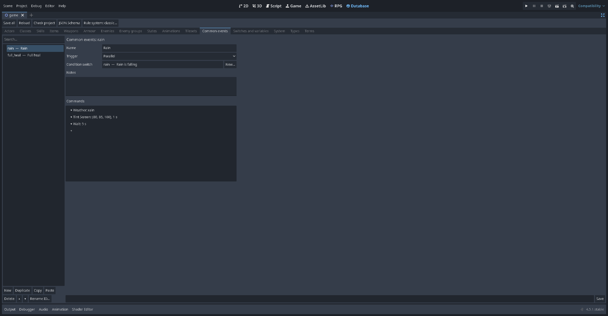

# Lesson 5: Cutscenes and common events

In this lesson you make the game's opening scene: a guard walks up to the hero, a balloon pops over the hero's head, and they talk. Then you make a **common event**, a list of commands you can use from anywhere.

## 1. An autorun event

A cutscene is usually an event with the trigger **Autorun**. It starts as soon as its page is active, and the player can't move until it ends.

1. On the starting map, make an invisible event (no graphic) anywhere, ID `intro`.
2. Trigger: **Autorun**.
3. Commands:

   ```
   ◆ Set Move Route: guard  (↑ Up, ↑ Up, ↑ Up, Turn Left)  [Wait until done]
   ◆ Show Balloon Icon: player, exclamation
   ◆ Text: Guard: You there! The captain wants to see you.
   ◆ Text: \N[hero]: Me? What did I do?
   ◆ Control Self Switch: A = ON
   ```

4. Add **page 2** with the condition *Self switch A is ON*, no commands and trigger *Action button*.

**Why page 2?** Autorun repeats for as long as its page is active. Without a way out, the scene would play forever. Turning self switch A ON makes page 2 the active page, and page 2 does nothing. (*Erase Event* also stops it, but only until the player leaves the map.)

## 2. Move routes

**Set Move Route** moves a character: `player`, `this` event or any event by its ID. Build the route with the buttons:

- **Move**: the eight directions, forward, backward, random, toward or away from the player.
- **Turn**: the four directions, 90° left or right, around, random, toward or away from the player.
- **Other**: jump, wait, speed, frequency, graphic, opacity, switch ON/OFF, sound, walking and stepping animation, direction fix, walk through, hide and show.

Options: **Repeat**, **Skip if blocked**, and **Wait until done** (the event waits before the next command). Press **Preview** to watch the route drawn on the map in the editor.

An event's page can have a **Custom route** as its movement too, for guards who patrol.

## 3. Screen effects

| Command | What it does |
| --- | --- |
| Fade Out Screen / Fade In Screen | Fades to black and back |
| Tint Screen | Colours the whole screen (red, green, blue %) over some seconds: dusk, night, a flashback |
| Flash Screen | A quick flash (lightning, a hit) |
| Shake Screen | Shakes the screen (an earthquake) |
| Set Weather Effects | None, rain or snow, with a power |
| Show / Move / Erase Picture | Pictures over the map: a letter, a portrait, a title card |
| Scroll Map | Moves the camera away from the player and back |
| Show Animation | A battle animation on a character (a spell on the map) |
| Show Balloon Icon | `!`, `?`, a note, a heart, anger, sweat, frustration, silence, a light bulb, Zzz |
| Wait | Waits some seconds |

Most of them have **Wait until done** (Show Animation calls it *Wait for completion*, and it is off by default).

## 4. Parallel events

An event with the trigger **Parallel** runs over and over in the background while the player moves. Use it for things that keep happening:

```
Parallel event "waves"
◆ Play SE: (a wave sound)
◆ Wait: 4.0
```

A parallel event shouldn't stop the player; avoid messages in it.

## 5. Common events

A **common event** is a command list that belongs to the whole game, not to a map. Make them on the Database's **Common events** tab.



Each one has a **Name**, its commands, and a **Trigger**:

| Trigger | Runs… |
| --- | --- |
| None | only when called with **Call Common Event**, or used by an item or skill |
| Autorun | while its **Condition switch** is ON, like an autorun event on every map |
| Parallel | in the background while its **Condition switch** is ON, on every map |

Example: a `full_heal` common event

```
◆ Play SE: heal
◆ Recover All: whole party
◆ Text: Your party feels refreshed!
```

Now any event can do `◆ Call Common Event: full_heal`. An item can run one too (Lesson 6): a *Tent* that calls `full_heal`.

## 6. Moving between maps in a cutscene

**Transfer Player** with *Fade* set moves the player and fades on the way. To take other characters along, give them the same story switch as a page condition on the new map, or place them with **Set Event Location**.

## Try it yourself

- Make the guard walk *with* the player to the castle: **Set Move Route** for both, without *Wait until done* on the first so they move together.
- Start a rainstorm when the player enters the forest: a Parallel event that runs `Set Weather Effects: rain` and then **Erase Event** (so it only runs once per visit).
- Show the map's name differently: **Change Map Name Display** turns the name box on and off.

Next: [Lesson 6: The database](Lesson-6-The-Database.md).
