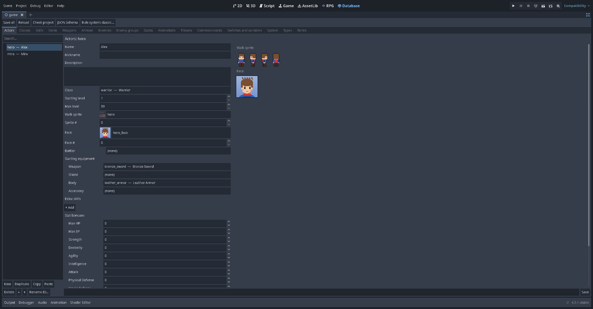
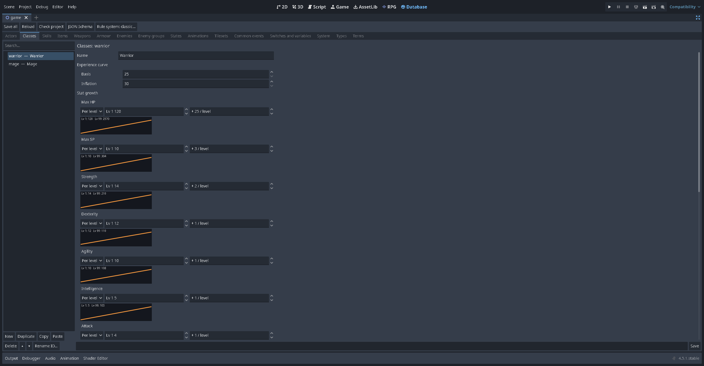
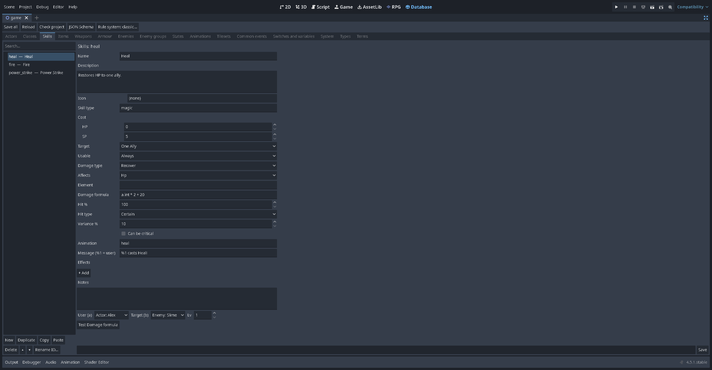
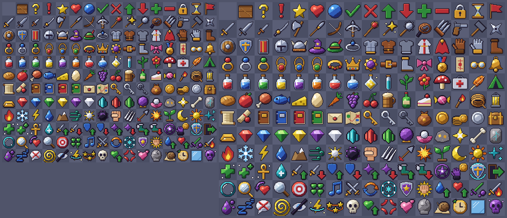
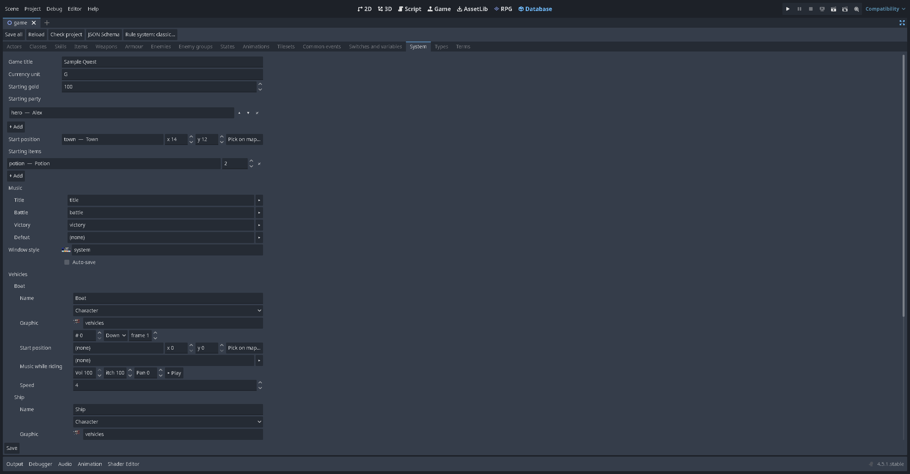

# Lesson 6: The database

The **Database** tab holds everything that isn't a map: the heroes, their classes and skills, items and equipment, monsters, states, and the game's settings. In this lesson you add a new hero, a healing item, a sword and a spell, and you change the starting party.

Press **F8** on the RPG tab, or click **Database** at the top of Godot's window.

## How every tab works

- The list on the left, with a search box. Each record shows as `id — Name`.
- **New**, **Duplicate**, **Copy**, **Paste**, **Delete**, the ▲ ▼ arrows to reorder, and **Rename ID…** under the list.
- The record's fields on the right, with a preview of its pictures.
- **Save** saves this tab; **Save all** (top left) saves every changed tab.
- **Check project** lists mistakes, such as a reference to a record that doesn't exist.

IDs are names (`potion`, `bronze_sword`), which makes events easy to read. **Rename ID…** updates every place in the project that uses the ID. A deleted record's ID is retired and never reused, so old saves and events can't suddenly point at something else.

The stats you see (HP, SP, Strength…) come from the project's **rule system**. The starter project uses *Classic*. See [Rule systems](Rule-Systems.md) for the VX Ace style and OSR systems.

## The tabs

| Tab | What it holds |
| --- | --- |
| **Actors** | The heroes: name, nickname, description, class, starting and max level, walk sprite, face, battler and side-view battler, starting equipment, extra skills, stat bonuses, traits |
| **Classes** | EXP curve, stat growth (per level, or a curve with a graph), skills learned at each level, which weapon and armour types can be equipped, traits |
| **Skills** | Icon, skill type, cost, target, where it can be used, damage type, element, damage formula, hit %, variance, criticals, animation, battle message, effects |
| **Items** | Icon, price, consumed or not, key item, target, where it can be used, animation, effects |
| **Weapons**, **Armour** | Icon, type (and slot for armour), price, stat changes, animation (weapons), traits |
| **Enemies** | Battler picture and hue, level, stats, EXP, gold, item drops, action patterns, traits |
| **Enemy groups** | Which enemies appear and where, can escape, battle view and system, battle events ([Lesson 7](Lesson-7-Battles.md)) |
| **States** | Poison, sleep and friends: icon, priority, restriction, how long they last, damage each turn, removal by walking or damage, messages, traits |
| **Animations** | Battle animations: a sprite sheet cut into frames, flashes and sounds |
| **Tilesets** | The tile sheets and autotiles of each tileset, and passability |
| **Common events** | [Lesson 5](Lesson-5-Cutscenes-and-Common-Events.md) |
| **Switches and variables** | Their labels, folders, descriptions; variable types and starting values |
| **System** | Title, currency, starting gold, party, position and items, music, window style, icons, auto-save, battle settings, vehicles |
| **Types** | Lists of names: elements, skill types, weapon and armour types |
| **Terms** | The words the game uses on its screens (*Attack*, *Items*, *Level*…), for renaming or translating |

## 1. A new hero

1. On **Actors**, press **New**. Type the ID `bram` and the name `Bram`.
2. **Class**: pick *Warrior* (or another class).
3. **Walk sprite** and **Sprite #**: choose a character from a sheet. **Face** and **Face #**: a face for the message box and menus.
4. **Starting equipment**: choose a weapon and body armour.
5. Press **Save**.

To make Bram join during the game, an event uses **Change Party Member** (*Add*, `bram`). To have Bram from the start, open **System** and add him to **Starting party**.

## 2. Classes and levels

A class decides how its actors grow. Each stat is either **Per level** (a number added each level) or a **Curve** (the value at level 1, the value at level 99, and a shape), drawn as a graph. **Skills learned** lists a skill and the level it's learned at.

## 3. A healing item

1. On **Items**, select `potion` and press **Duplicate**. Rename the ID to `mega_potion` and the name to `Mega Potion`.
2. **Icon**: click the box to open the icon sheet; type `potion` in its search to find the potions.
3. **Price**: 150. **Consumed when used**: on. **Target**: one ally. **Usable**: always (menu and battle).
4. **Effects**: change the *recover* effect to a bigger amount.

Effects can recover HP or SP, deal damage, add or remove a state, raise a stat permanently (*grow*), teach a skill, or run a **common event**.

## 4. A spell

1. On **Skills**, press **New**: `firebolt`, *Firebolt*.
2. **Skill type**: Magic. **Cost**: 6 SP. **Target**: one enemy. **Element**: fire.
3. **Damage type**: *damage* (the others are *none*, *recover* and *drain*), **Affects**: HP. **Damage formula**: for example `a.int * 2 + 30 - b.mdef / 2`, where `a` is the user and `b` the target (the sample's *Fire* skill uses `a.int * 2 + 12 - b.mdef / 2`). Formulas use a small, safe expression language; they can't run arbitrary code.
4. **Battle animation**: an animation, or one of the built-in effects (slash, fire, ice, thunder, heal, hit).
5. Add the skill to a class's **Skills learned** at level 3.

## 5. Icons

The starter icon sheet has 192 icons drawn for the kit (CC0): potions, swords, shields, armour, rings, books, element and state symbols. Records pick one with the **Icon** field: a grid of the sheet you can search by name. Menus, the shop, battle lists and the `\I[n]` message code draw them.

*System > Icon sheet* switches to another sheet laid out like RPG Maker's IconSet (for example one you imported); *System > Show icons* off hides icons everywhere.

## 6. States

States work in battle and on the map:

- **Lasts** a number of turns (between *At least* and *At most*), may be **removed at battle end**, and has a **chance removed by damage**.
- **Damage each turn**: a share of HP or SP, plus a fixed amount, which may or may not knock out.
- **Removed by walking** after a number of steps on foot.
- **Change while walking** (RPG Maker 2000 style): HP or SP damage or recovery every N steps.

*System > Knockout by slip damage* (off by default) lets map damage knock actors out; the game is over when the whole party falls. When it's off, at least 1 HP is always left. Damage floors take *System > Damage floor* HP per step and never knock anyone out.

## 7. The System tab

Worth a look now: **Game title**, **Title screen image**, **Currency unit**, **Starting gold**, **Starting party**, **Starting items**, the **Music** for the title, battles, victory and defeat, **Window style**, and **Auto-save** (saves to the last slot after every map transfer). The battle settings come in the next lesson.

## Switching rule systems

**Rule system…** at the top switches the whole project to another rule system (stats, resources, formulas). It shows a preview of every stat, resource, formula and command it affects, writes a backup first and deletes nothing. Old stat values are kept, not converted. See [Rule systems](Rule-Systems.md).

## Try it yourself

- Make a stronger sword and sell it in the shop: the shop compares it with what each actor has equipped.
- Rename `Gold` to `Crowns` (System > Currency unit) and see the shop and `\G` change.
- Add a skill type *Songs* on **Types**, and a bard class that can use it.

Next: [Lesson 7: Battles](Lesson-7-Battles.md).
