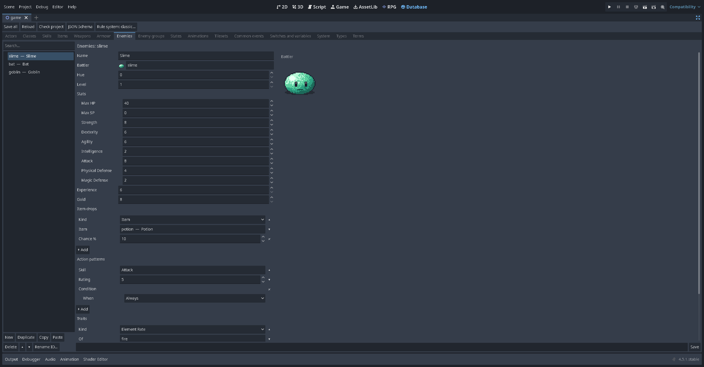
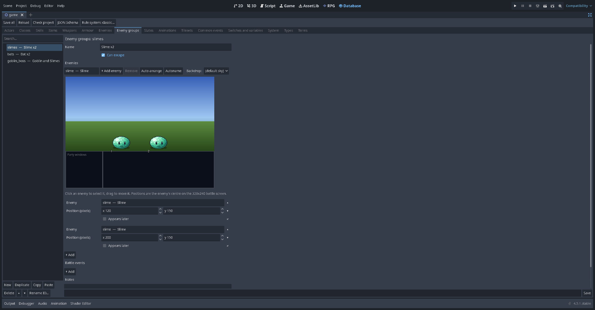
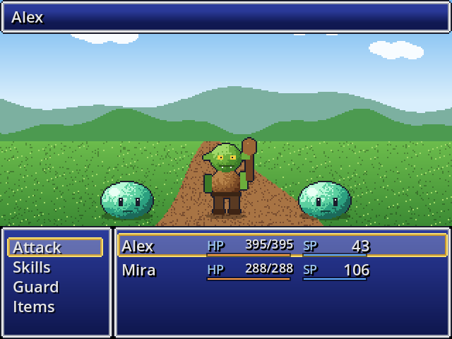
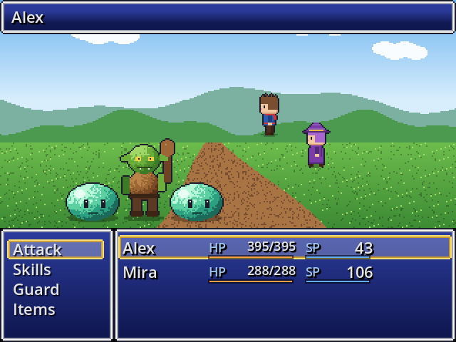
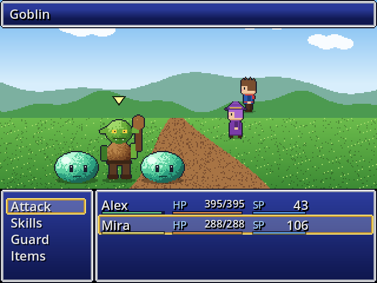
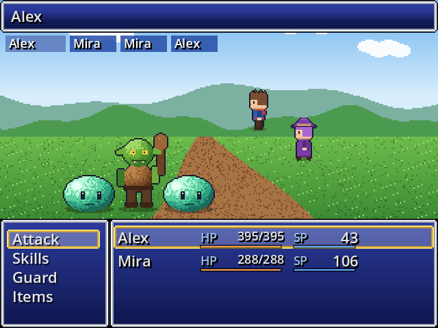

# Lesson 7: Battles

In this lesson you make a monster, put it in an enemy group, make it appear in the grass, and set up a boss fight from an event. Then you choose how battles look and play: front or side view, and turn based, ATB or CTB.

## 1. A monster

On the Database's **Enemies** tab, press **New**: `wolf`, *Wolf*.



- **Battler**: the picture (from the `Monster` folder) and a **Hue** to recolour it, so one picture can make several monsters.
- **Level** and **Stats**: HP, SP and the rule system's stats.
- **Experience** and **Gold** won.
- **Item drops**: items with a chance %.
- **Action patterns**: what it does. Each row is a skill (or one of the 2003 basic actions: *attack*, *double attack* — two hits, *guard*, *observe* — a message and nothing else, *charge up* — the next attack hits harder, *self destruct* — the monster's remaining HP as damage to the party, then it falls, *escape* — it leaves the battle and its rewards, or *transform* — it becomes the enemy picked under **Becomes**), a **Rating** (1–10: higher is chosen more often), and a **Condition**: *Always*, a **Turn** (and then every N turns), its **Own HP %** or **Own MP %**, *Has a state* (say, cure itself when poisoned), the **Party level** (average or highest), **Monsters present** (how many of its own side are still up — "flee when alone"), a **Variable**, or a **Switch**. MP compares the spell resource as a percent, like the MP battle-event condition. Optionally **Switch ON / Switch OFF**: switches turned on or off the moment the action is used — 2003's way of chaining phases ("after using Charge Up, switch 12 ON enables the big attack").
- **Traits**: element rates (weak to fire), state resistances and so on.

## 2. An enemy group

Monsters fight in **enemy groups** (RPG Maker's *troops*). On **Enemy groups**, press **New**:



1. **+ Add enemy** adds the selected enemy to the picture of the battle screen. Drag enemies to place them; **Auto-arrange** spaces them evenly. The *Backdrop* menu only changes the preview.
2. **Autoname** names the group after its members (*Wolf x2*).
3. **Can escape**: whether the party can run.
4. **Appears later** on a member keeps it out of the battle at the start. A battle event brings it in with **Enemy Appear** (section 5).
5. **Appear %** on a member gives it a chance to miss the fight (RPG Maker's random appearance), so an ambush varies from fight to fight. One that misses behaves exactly like *Appears later* — **Enemy Appear** can still bring it in — and at least one member always fights.
6. **Battle test** on this tab starts this fight at once in a game window (save first). *Game > Battle test…* on the RPG tab lets you choose the group, the party and their levels.

## 3. Random encounters

Open your map's **Properties** (right-click it in the map tree):

- **Encounter steps (average)**: about how many steps between battles.
- **Encounters > Add enemy group**: the group, a **weight** (a group with weight 20 appears twice as often as one with 10) and, if you like, the **regions** where it appears. Paint those region numbers in Region mode ([Lesson 1](Lesson-1-Your-First-Map.md)); a group with no regions appears anywhere on the map.

When a random battle starts there is a small chance of a **preemptive** attack (the party moves first) or a **surprise** attack (the enemies do): 5% and 3% when the party's average agility is at least the enemies', else 3% and 5%.

The **party abilities** (VX Ace / MV) bend these rules: a trait any party member carries — on an actor, class, equipment or state — applies to the whole party. *Encounter Half* doubles the steps between battles, *Encounter None* stops random battles entirely, *Cancel Surprise* removes the ambush chance and *Raise Preemptive* quadruples the first-strike one. One member carrying the trait is enough.

**Battle start chances** (Database > System) add the RPG Maker 2003 openings on top of that, each with a percent chance on a random encounter:

| Start | Gauges | Formation |
| --- | --- | --- |
| Initiative | party full, enemies empty | unchanged, "*The party strikes first!*" |
| Back attack | enemies full, party empty | the group is mirrored and faces the other way |
| Surround | party full, enemies empty | the group packs around the middle |
| Pincer | enemies full, party empty | the group splits to both flanks — and there is no escaping |

The chances share one roll (in the order above) and the rest of the encounters start normally. All 0 (the default): the preemptive / surprise roll above runs instead, so an existing game keeps its behavior. A map can override the chances for itself (**Map properties > Override battle start chances**), and a map's `encounters.start_odds_regions` swaps them per region — `{"regions": [3, 7], "odds": {"pincer": 100}}` for pincers in the mountains; an empty `regions` list is the catch-all for everywhere else. Gauges matter under ATB / CTB; in a turn-based battle initiative and surround play like a preemptive strike, a back attack and a pincer like a surprise attack.

**Change Encounter** turns random battles off and on (for example during a cutscene).

## 4. A boss fight from an event

```
◆ Text: Goblin King: You'll never take my crown!
◆ Battle Processing: goblin_boss   (Can escape: off, Continue when lost: on)
  If won
    ◆ Text: The Goblin King falls...
    ◆ Control Self Switch: A = ON
  If lost
    ◆ Text: You wake up back in the village.
    ◆ Transfer Player: village (10, 8)
    ◆ Recover All: whole party
```

**Battle Processing** options:

| Option | Meaning |
| --- | --- |
| Enemy group source | Who you fight: *Enemy group* picks one here, *Enemy group named by a variable* fights the group whose ID the variable holds (checked when the battle starts), and *Random encounter* rolls this map's own encounter list, exactly as a step-triggered battle would |
| Can escape | Allows *Escape*; adds an *If escaped* branch |
| Continue when lost | Without it, losing is game over; with it, the *If lost* branch runs |
| Battle scene | Empty for the default battle, or your own scene (see [For programmers](For-Programmers.md)) |
| Background | Empty for the map's battle background |
| Advantage | Normal, preemptive, surprise, or one of the [2003 starts](#3-random-encounters): initiative, back attack, surround, pincer — a pincer also blocks escaping |
| Store outcome in | A variable that gets the result |

**The defeat handler** (Database > System): when the party loses a battle *Continue when lost* is off for, a **Defeat handler** common event takes the place of Game Over — an inn, a "*you blacked out and crawled back*" scene. An optional **Defeat transfer** carries the party to a map first (with **Defeat facing**), then the common event runs and the event that started the battle goes on as though nothing happened. Without a handler, losing is Game Over as usual.

## 5. Battle events

An enemy group's **Battle events** run *during* its battles: a boss that taunts at turn 3, calls for help below half HP, or a story fight that ends after five turns.

Each battle event page has **Conditions** (turn number, *turn end*, an enemy's HP or MP, an actor's HP or MP, an enemy's or actor's own turns taken, a command an actor used this turn, a switch, a variable), a **Span** (*once per battle*, *once per turn*, or *every check*), a priority, and **Commands**. All the usual commands work: messages, switches, Change HP / SP, Change State, music, and so on. **Tint Screen**, **Flash Screen** and **Shake Screen** act on the battle itself — the tint colours the backdrop and the battlers (not the message and status windows), the flash and the shake move the field — and the battle's screen state ends with the fight: the map's tint, flashes and shakes wait underneath and come back exactly as they were. Conditions combine with AND: a page runs only when all of them hold. *Turn end* is true only at the moment a turn ends (under ATB / CTB, when every battler has had one turn), so a page with that condition runs its commands after each turn — poison damage, regrowth, a boss gathering power.

The *turns taken* conditions count each battler's own turns, not the battle's: a battler that lost its turn to a state still counts it (the battle scene's *Span* still follows the battle turn). *Command used* holds when the actor took that action — *Attack*, *Skill* (optionally one skill), *Item*, *Guard*, *Escape*, *Row*, or an *Event* command — during the current battle turn, which pairs well with a page that answers a specific skill. An Event command (2003's *Link to Event*: an entry in the actor's or class's [Battle commands](Lesson-6-The-Database.md) list) matches by its own id — so a command with the id `transform` is caught by both `transform` and `event` — which is how a boss answers the hero's special move with a cutscene mid-fight. MP conditions compare the spell resource as a percent (SP in the classic ruleset, MP in VX Ace); in a ruleset with no second resource they never hold.

In battle events (and common events they call), **Conditional Branch** gains RM2000/2003's battle checks alongside its usual ones: the turn, an enemy's HP and an actor's HP, plus *Actor can act* (present and not held back by a state), *Enemy can act*, and *Enemy is the target* — true when the action that just ran targeted that enemy alone. They are false with a warning anywhere else.

**Enemy Appear** (in the *Scenes* category) brings in a member marked *Appears later*. Its picture fades in and "*Slime B appears!*" shows. Pick the enemy by its number in the group (the number on the battle picture), or *Every hidden enemy*. From then on it fights and can be targeted like the others.

The party commands reach the other side too: **Change HP / SP**, **Change State** and **Recover All** take an enemy target (*Enemy #* by its number in the group, or *Entire troop*). A change that defeats an enemy collapses it, counts it as defeated and gives its rewards; Change State respects the state's resist rates unless *Ignore resist rates* is on, and the display refreshes by itself.

**End Battle** (also in *Scenes*) stops the fight at once: *Abort* ends it like an escape with no rewards (RPG Maker's Abort Battle), *Win* takes the victory (with or without rewards) and *Lose* takes the defeat. The Battle Processing command that started the fight continues down the matching branch.

**Transform Enemy** turns one of the group's members into a different enemy. It keeps its slot — its number in the group, its position on the battle screen, its *Appears later* flag (a hidden member transforms and stays hidden) and the *A*/*B* suffix of a duplicated enemy — while its stats, actions, graphic and rewards come from the new enemy. Pick what happens to its HP: *Keep* carries it over (clamped to the new maximum, so a goblin with 150 HP turned into a 40 HP slime starts at 40), *Keep percentage* carries its share of the maximum over, or *Start at full* refills it. States are kept unless *Remove its states* is on. Enemy HP conditions and victory rewards measure the new enemy from then on.

**Force Flee** (2003) makes someone run instead: *Enemy #* or *Every enemy* — a fled enemy leaves the battle, takes nothing from the fight and gives no rewards, and when the last one goes the battle is won — or *The party*, which ends the battle as an escape with no chance roll, even when the group says *Can escape* is off. Useful for a monster that bolts at low HP, or a story fight the party is meant to lose without a game over.

**Force Action** makes a battler use a skill or an item: a boss's signature move every third turn, a counterattack the moment it is hit, a story beat where the knight shields the princess. The subject is any member of the group (by its number) or any actor in the party; it does not need to know the skill, only the SP for it. Aim at its *last target*, a *random* one, or a number in the target row. *Right now* performs the action at once, outside the turn order — nobody's turn or gauge is used. *At its next turn* queues it instead: the battler uses that action when its turn comes (the player is not asked for it, and a timed battle's gauge is spent as usual). A subject that cannot act — dead, hidden or restricted — skips the command quietly, as in RPG Maker.

**Change Party Member** works during a battle: an added actor joins the field at once (status row, side-view sprite and a turn gauge under ATB / CTB), a removed one leaves the fight, and victory EXP goes to the members present at the end. *Only for this battle* adds the actor for the fight and takes them out of the party again when it ends.

For reinforcements, give the page an *Enemy HP* condition at 0%. When the last enemy on screen falls, the new ones appear and the battle goes on.

Enemy Appear, Force Flee, Transform Enemy and Force Action only work in a battle: in battle events, or in a common event they call. On a map event they stop the event with an error, and the export checks warn about it.

## 6. Battle style

Two settings decide how the default battle looks and plays. Set them on **Database > System**. An enemy group can override both (its *Battle view* and *Battle system*, "As in System" by default). A map can too, with `battle_view` / `battle_system` in its `.map.json` file (there is no field for them in the Map properties dialog).

### Battle view

| Front view (2000, VX Ace) | Side view (2003, MV/MZ) |
| --- | --- |
|  |  |

- **Front view**: you see the enemies; the party is in the windows.
- **Side view**: enemies on the left, the party on the right as animated figures. Each actor's *Side-view battler* (Actors tab) is an MV `sv_actors` sheet or a 2003 BattleCharSet from an imported pack. Without one, the actor's walk sprite is used, facing left.

### Battle system

| System | How it plays |
| --- | --- |
| **Turn based** | Everyone chooses, then the round plays out by agility (2000, VX Ace, MV). |
| **ATB** (Active Time) | Gauges fill by speed; a battler acts when its gauge is full (2003, MZ's *Time Progress*). **ATB mode**: *Wait* stops time while you choose; *Active* keeps it running. |
| **CTB** (Turn order) | The coming turn order is shown at the top of the screen; one battler acts at a time. |

| ATB | CTB |
| --- | --- |
|  |  |

Under ATB and CTB, a battle "turn" (for battle events and enemy turn conditions) ends when every battler has had one turn. With ATB, **Shift** or **Tab** passes the command to the next actor whose gauge is full.

The speed a gauge fills comes from the rule system (`atb_speed`, else the agility stat).

## 7. After the battle

The party gets EXP, gold and drops, and actors level up, learn skills and show messages. Party abilities reach the take: *Gold Double* on any living member multiplies what a victory pays (200% doubles, and the percents multiply across members) and *Drop Item Double* the drop chance. The kit's **Victory aftermath** plugin replaces those messages with a results screen; **Enemy HP gauges**, **Party formation** and **Bestiary** also change battles. See [Plugins](Plugins.md).

## Try it yourself

- Make a slime that gets angry: an action pattern *Power Strike* with the condition *Own HP %* ≤ 50.
- Add a battle event to the boss: at turn 2, `Show Text: "You'll pay for that!"` and give the boss a state that raises its attack.
- Add a slime to the boss group, mark it *Appears later*, and bring it in at turn 3 with **Enemy Appear**.
- Try every battle style on the same group with **Battle test**.

Next: [Lesson 8: Playtest, debug and share](Lesson-8-Playtest-Debug-and-Share.md).
