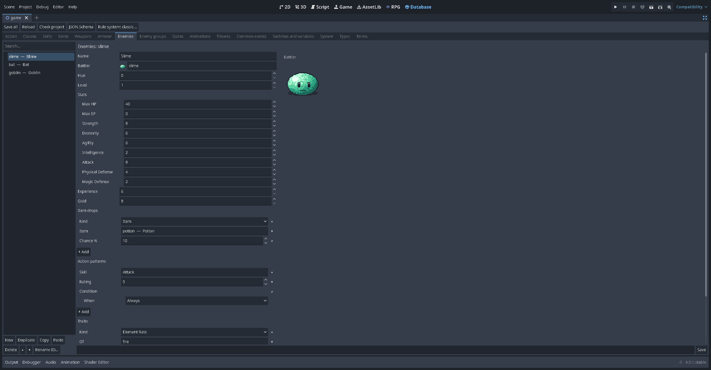
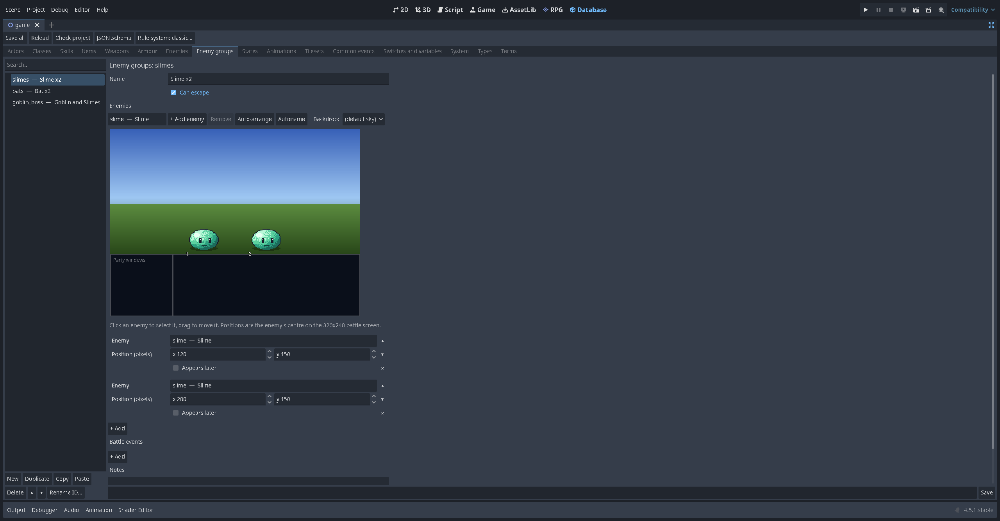
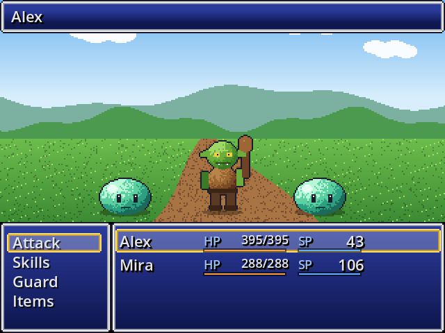
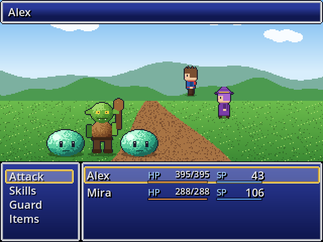
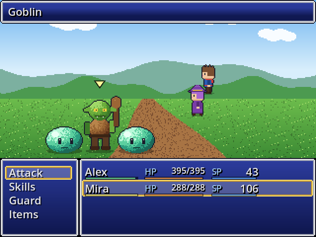
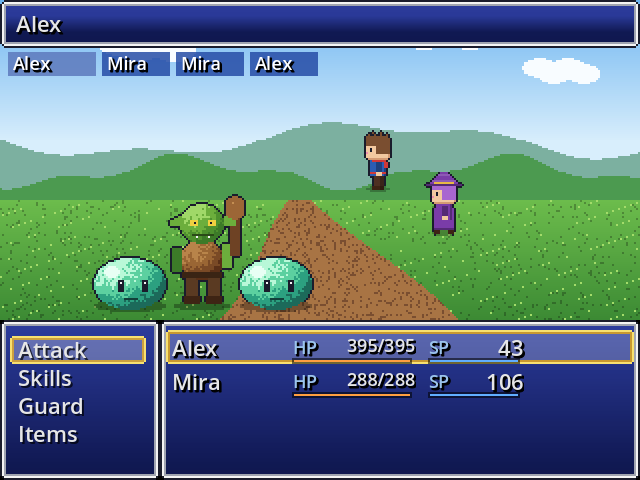

# Lesson 7: Battles

In this lesson you make a monster, put it in an enemy group, make it appear in the grass, and set up a boss fight from an event. Then you choose how battles look and play: front or side view, and turn based, ATB or CTB.

## 1. A monster

On the Database's **Enemies** tab, press **New**: `wolf`, *Wolf*.



- **Battler**: the picture (from the `Monster` folder) and a **Hue** to recolour it, so one picture can make several monsters.
- **Level** and **Stats**: HP, SP and the rule system's stats.
- **Experience** and **Gold** won.
- **Item drops**: items with a chance %.
- **Action patterns**: what it does. Each row is a skill (or *attack*, *guard*, *wait*, *escape*), a **Rating** (1–10: higher is chosen more often) and a **Condition**: *Always*, a **Turn** (and then every N turns), its **Own HP %**, or a **Switch**.
- **Traits**: element rates (weak to fire), state resistances and so on.

## 2. An enemy group

Monsters fight in **enemy groups** (RPG Maker's *troops*). On **Enemy groups**, press **New**:



1. **+ Add enemy** adds the selected enemy to the picture of the battle screen. Drag enemies to place them; **Auto-arrange** spaces them evenly. The *Backdrop* menu only changes the preview.
2. **Autoname** names the group after its members (*Wolf x2*).
3. **Can escape**: whether the party can run.
4. **Appears later** on a member keeps it out of the battle at the start. A battle event brings it in with **Enemy Appear** (section 5).
5. **Battle test** on this tab starts this fight at once in a game window (save first). *Game > Battle test…* on the RPG tab lets you choose the group, the party and their levels.

## 3. Random encounters

Open your map's **Properties** (right-click it in the map tree):

- **Encounter steps (average)**: about how many steps between battles.
- **Encounters > Add enemy group**: the group, a **weight** (a group with weight 20 appears twice as often as one with 10) and, if you like, the **regions** where it appears. Paint those region numbers in Region mode ([Lesson 1](Lesson-1-Your-First-Map.md)); a group with no regions appears anywhere on the map.

When a random battle starts there is a small chance of a **preemptive** attack (the party moves first) or a **surprise** attack (the enemies do): 5% and 3% when the party's average agility is at least the enemies', else 3% and 5%.

**Change Encounter** turns random battles off and on (for example during a cutscene).

## 4. A boss fight from an event

```
◆ Text: Goblin King: You'll never take my crown!
◆ Battle Processing: goblin_boss   (Can escape: off, Continue when lost: on)
  If won
    ◆ Text: The Goblin King falls...
    ◆ Control Self Switch: A = ON
  If lost
    ◆ Text: You wake up back in the village.
    ◆ Transfer Player: village (10, 8)
    ◆ Recover All: whole party
```

**Battle Processing** options:

| Option | Meaning |
| --- | --- |
| Enemy group | Who you fight |
| Can escape | Allows *Escape*; adds an *If escaped* branch |
| Continue when lost | Without it, losing is game over; with it, the *If lost* branch runs |
| Battle scene | Empty for the default battle, or your own scene (see [For programmers](For-Programmers.md)) |
| Background | Empty for the map's battle background |
| Advantage | Normal, preemptive or surprise |
| Store outcome in | A variable that gets the result |

## 5. Battle events

An enemy group's **Battle events** run *during* its battles: a boss that taunts at turn 3, calls for help below half HP, or a story fight that ends after five turns.

Each battle event page has **Conditions** (turn number, an enemy's HP, an actor's HP, a switch), a **Span** (*once per battle*, *once per turn*, or *every check*), a priority, and **Commands**. All the usual commands work: messages, switches, Change HP / SP, Change State, music, and so on.

**Enemy Appear** (in the *Scenes* category) brings in a member marked *Appears later*. Its picture fades in and "*Slime B appears!*" shows. Pick the enemy by its number in the group (the number on the battle picture), or *Every hidden enemy*. From then on it fights and can be targeted like the others.

For reinforcements, give the page an *Enemy HP* condition at 0%. When the last enemy on screen falls, the new ones appear and the battle goes on.

Enemy Appear only works in a battle: in battle events, or in a common event they call. On a map event it stops the event with an error, and the export checks warn about it.

## 6. Battle style

Two settings decide how the default battle looks and plays. Set them on **Database > System**. An enemy group can override both (its *Battle view* and *Battle system*, "As in System" by default). A map can too, with `battle_view` / `battle_system` in its `.map.json` file (there is no field for them in the Map properties dialog).

### Battle view

| Front view (2000, VX Ace) | Side view (2003, MV/MZ) |
| --- | --- |
|  |  |

- **Front view**: you see the enemies; the party is in the windows.
- **Side view**: enemies on the left, the party on the right as animated figures. Each actor's *Side-view battler* (Actors tab) is an MV `sv_actors` sheet or a 2003 BattleCharSet from an imported pack. Without one, the actor's walk sprite is used, facing left.

### Battle system

| System | How it plays |
| --- | --- |
| **Turn based** | Everyone chooses, then the round plays out by agility (2000, VX Ace, MV). |
| **ATB** (Active Time) | Gauges fill by speed; a battler acts when its gauge is full (2003, MZ's *Time Progress*). **ATB mode**: *Wait* stops time while you choose; *Active* keeps it running. |
| **CTB** (Turn order) | The coming turn order is shown at the top of the screen; one battler acts at a time. |

| ATB | CTB |
| --- | --- |
|  |  |

Under ATB and CTB, a battle "turn" (for battle events and enemy turn conditions) ends when every battler has had one turn. With ATB, **Shift** or **Tab** passes the command to the next actor whose gauge is full.

The speed a gauge fills comes from the rule system (`atb_speed`, else the agility stat).

## 7. After the battle

The party gets EXP, gold and drops, and actors level up, learn skills and show messages. The kit's **Victory aftermath** plugin replaces those messages with a results screen; **Enemy HP gauges**, **Party formation** and **Bestiary** also change battles. See [Plugins](Plugins.md).

## Try it yourself

- Make a slime that gets angry: an action pattern *Power Strike* with the condition *Own HP %* ≤ 50.
- Add a battle event to the boss: at turn 2, `Show Text: "You'll pay for that!"` and give the boss a state that raises its attack.
- Add a slime to the boss group, mark it *Appears later*, and bring it in at turn 3 with **Enemy Appear**.
- Try every battle style on the same group with **Battle test**.

Next: [Lesson 8: Playtest, debug and share](Lesson-8-Playtest-Debug-and-Share.md).
