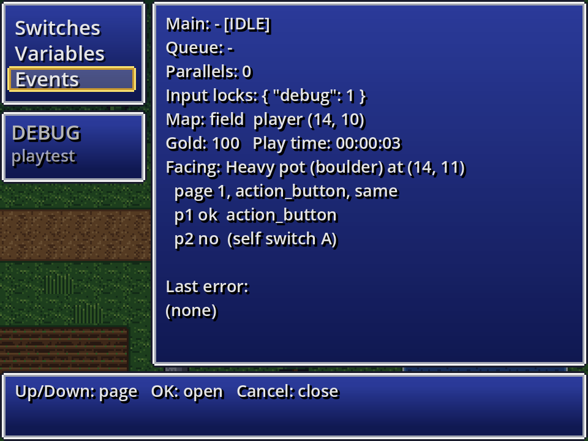
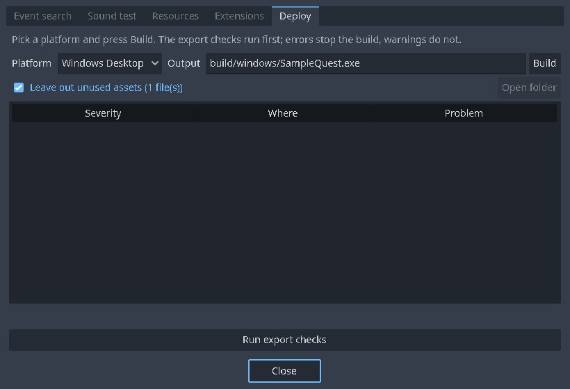
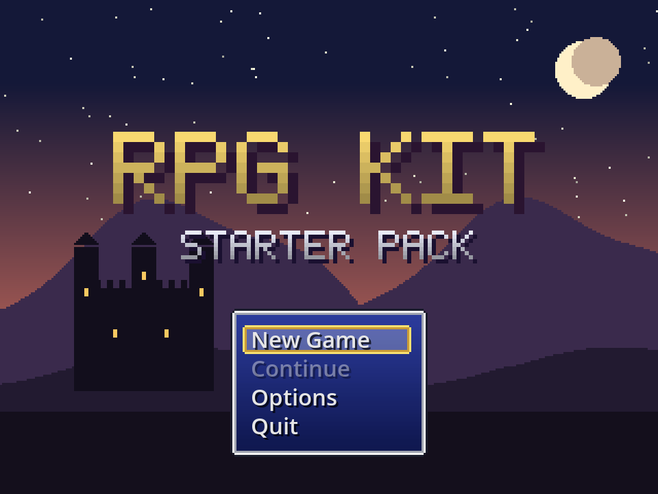

# Lesson 8: Playtest, debug and share

Your game is playable. In this last lesson you learn the playtest tools that find problems quickly, the checks the kit runs for you, and how to build a game that players can download.

## 1. Ways to playtest

| How | Starts |
| --- | --- |
| **▶ Playtest**, F9 or Ctrl+R | at the title screen |
| Right-click a tile in Event mode > **▶ Playtest from here** | on that tile, with a new game |
| **From here** on the toolbar, then click a tile | the same |
| *Game > Battle test…* or **Battle test** on the Enemy groups tab | straight into a battle |
| **Test** in an event's command list (right-click) | runs just the selected commands |

Before a playtest the whole project is checked, including whether the battle scene and the enabled extensions get what they need from the rule system. If something is wrong you get a list, with **Play anyway**, **Cancel** and **Show problems** (which opens the list on *Tools > Deploy*, where you can double-click each problem to jump to it).

## 2. Keys in the game

| Key | What it does |
| --- | --- |
| Arrow keys or WASD | Walk, move the cursor |
| Shift | Run (hold) |
| Z, Enter or Space | Talk, open, choose (OK) |
| X or Esc | Back; open the menu |
| Alt+Enter or F4 | Full screen |
| Mouse | Hover moves the cursor, click is OK, right click is Cancel, the wheel scrolls; click the map to walk there |
| Gamepad | D-pad or left stick moves; A is OK; B and Back cancel; X runs; Start and Y open the menu |

**Playtest only:**

| Key | What it does |
| --- | --- |
| F9 | The debug screen |
| Hold Ctrl | Walk through walls |
| F7 | Show the event overlay |

## 3. The debug screen



**F9** in a playtest opens it:

- **Switches** and **Variables**: see and change every value.
- **Events**: the event you are facing, all its pages, and for each page *which condition keeps it off*. When an event "does nothing", look here first.

When an event command fails in a playtest (a missing map, a bad reference), the game shows the error and where it happened (the map, the event and the page). Only that event stops; the game goes on.

## 4. The export checks

Open **Tools > Deploy** and press **Run export checks**:



They look for:

- references to maps, events, records, switches or files that don't exist;
- commands that are unknown or belong to an extension that is off (they are kept in the data, never deleted, but they block export);
- a battle scene or extension that needs something the rule system doesn't have;
- and other mistakes.

Each problem shows its **severity**, **where** it is, and what's wrong. **Double-click** a problem to jump to it. Errors block the build; warnings don't.

## 5. Build the game

The first time, Godot needs an **export preset** and **export templates**:

1. In Godot, open *Project > Export…*, press **Add…** and choose a platform (for example *Windows Desktop*, *Linux* or *macOS*).
2. If Godot says the export templates are missing, press **Manage Export Templates** and download them (once per Godot version).
3. Close the Export window. (The sample project already has a *Windows Desktop* preset.)

Then, on **Tools > Deploy**:

1. Pick the **Platform** and the **Output** file (for example `build/windows/MyGame.exe`).
2. Leave **Leave out unused assets** ticked: files your game never uses, and kit plugins it doesn't enable, are left out of the build.
3. Press **Build**. The checks run first; if there are no errors, the game is exported in the background while you keep working. **Open folder** shows the result.

You can also use Godot's own *Project > Export…* dialog, or the command line:

```bash
godot --headless --path . --export-release "Windows Desktop" build/windows/MyGame.exe
```

The included export preset leaves out the editor parts of the kit (`addons/rpg/editor/`, `addons/rpg_database/`), the tests, tools and docs. The exported game contains only the runtime and your game.

## 6. What players get



- A game that starts at your title screen, with **New Game**, **Continue**, **Options** and **Quit**.
- Saves in the player's user folder, with the play time and the map's name (or your own description with the *Save & autosave plus* plugin).
- MIDI music already rendered to audio: players need no synthesizer or sound bank.
- Window scaling that keeps the game's shape; *Options > Scaling: Pixel* keeps whole multiples for crisp pixels.

Playtest-only features (F9, Ctrl walk-through, starting from a tile, battle tests) do nothing in a release build.

## 7. Check a build from the command line

Every build understands `--rpg-smoke`: it starts a new game, runs the start map's events, prints `RPG_SMOKE OK ...` and quits with 0 (or 1 on failure). It's handy in a build script:

```bash
build/windows/MyGame.console.exe --headless -- --rpg-smoke
```

(The `.console.exe` exists for debug builds on Windows.)

## You're done!

You have made maps, events, a quest, a cutscene, heroes, items, monsters and battles, and built the game. Where next?

- [Lesson 9: Image-backed maps](Lesson-9-Image-Backed-Maps.md): build a map from one picture you drew, instead of tiles.

- [Plugins](Plugins.md): quests, lighting and a day/night clock, crafting, a bestiary, better messages and more, all one tick away.
- [Importing RPG Maker resources](Importing-RPG-Maker-Resources.md): use art and music from RPG Maker you own.
- [For programmers](For-Programmers.md): your own commands, screens and battle systems in GDScript.
