# Plugins

The kit ships twelve plugins, written for it from scratch and built on the same [extension hooks](For-Programmers.md#extensions) you can use yourself. Each adds features many RPG Maker games get from community plugins: better menus and messages, a quest log, lighting, crafting, battle extras.

## Turning a plugin on

Every plugin is **off** until you turn it on:

1. Open **Tools > Extensions**.
2. Tick the plugin and press **Apply** (this writes `rpg/project.json`).
3. Select it to see its settings; change them and press **Save settings** (this writes `rpg/extensions.json`).

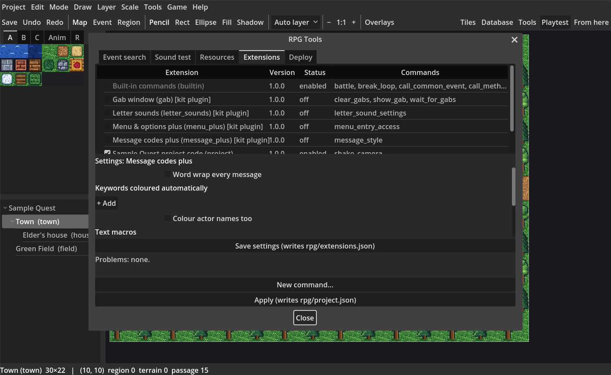

Plugin commands appear in the command picker under their own **★** categories. A command whose plugin is off fails with a clear message, and the export checks list it. A build from **Tools > Deploy** with *Leave out unused assets* leaves out the plugins your project doesn't use.

A project folder `extensions/<id>/` with the same ID as a kit plugin takes its place, so you can copy a plugin into your project and change it.

The full list of every setting is in the [plugins README](https://github.com/barnstorm/rpgodot_mkr/blob/main/addons/rpg/extensions/README.md).

## Menus and messages

### Menu & options plus (`menu_plus`)

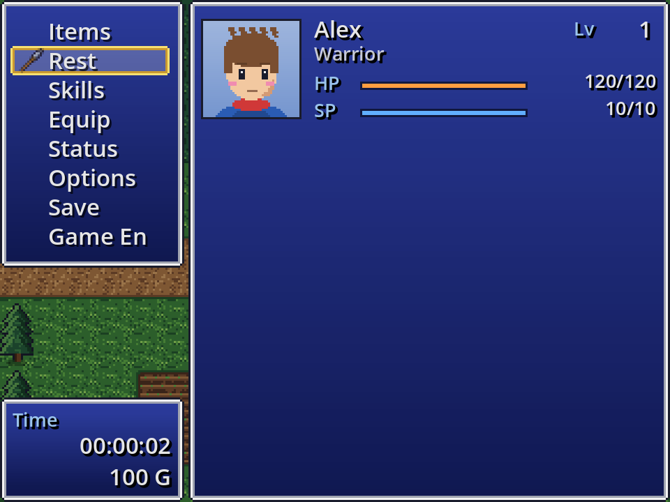

- Reorder or hide the main menu's commands (Items, Skills, Equip, Status, Options, Save, Game End).
- Add entries that run a common event or open a scene, shown or usable only while a switch is ON.
- A party of one skips choosing the actor for Skills, Equip and Status.
- Extra rows on the Options screen (on/off, a choice, a slider), copied into a switch or variable.

  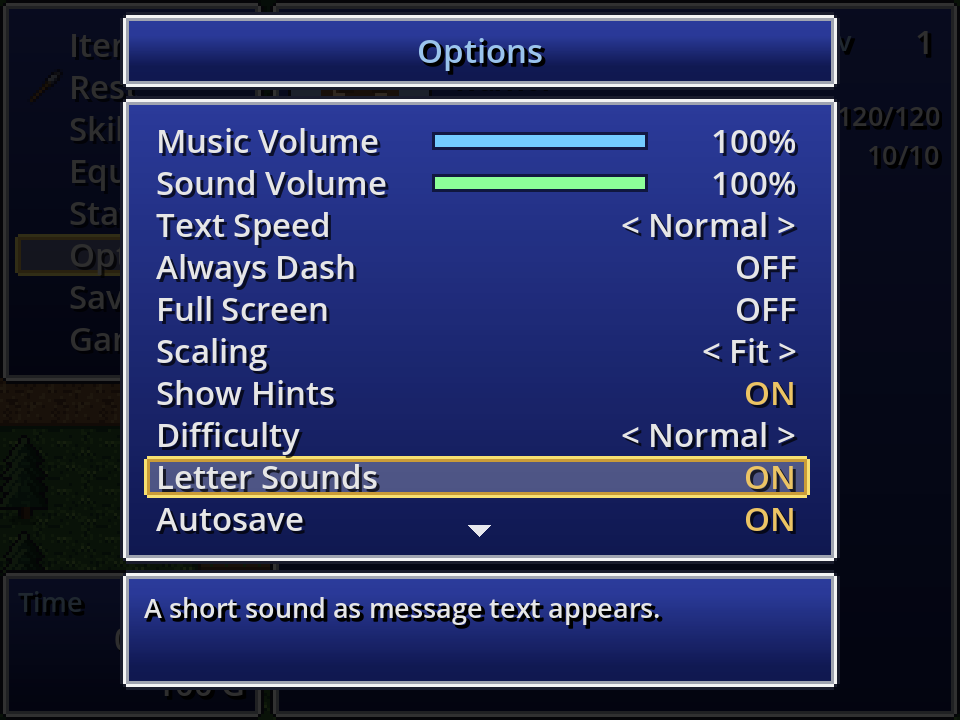

- Command: *Change menu entry* (show, hide, grey out or enable a command for the rest of the game).

### Message codes plus (`message_plus`)

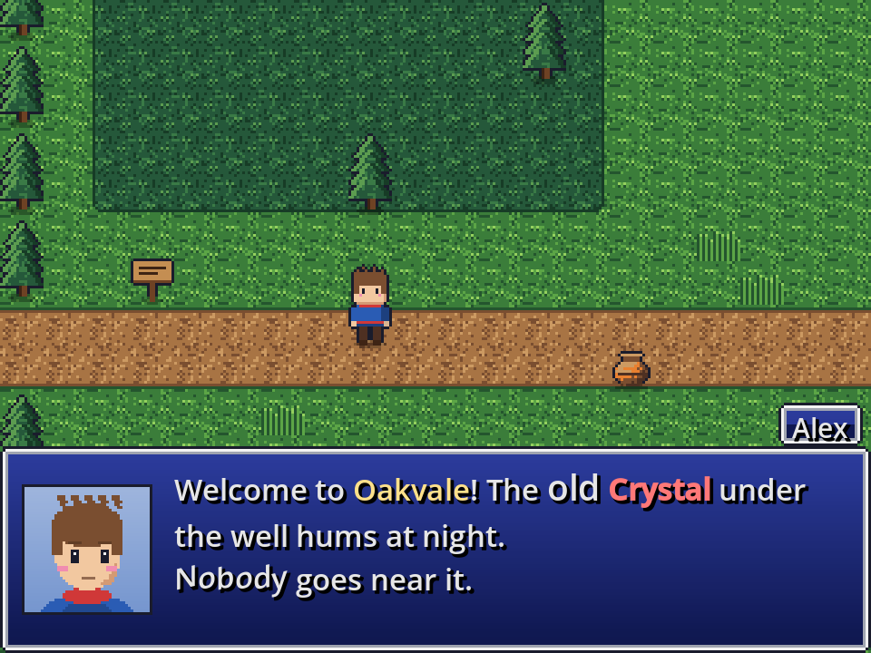

- `<wordwrap>` and `<nowrap>`, ` ` for a new line.
- `\{` and `\}` for bigger and smaller text, `\FS[n]` for a size.
- `<b>` bold and `<i>` italic.
- Keywords coloured automatically wherever they appear, actor names too.
- `\M[name]` text macros, and `\NB[left|center|right]` for the name box.
- Command: *Change message style*.

### Letter sounds (`letter_sounds`)

A short blip as text types, with a little pitch and volume variation. Spaces and punctuation are silent. Each actor can have their own sound (a *Letter sound* field on Actors). Codes `\LS[off]`, `\LS[on]`, `\LS[file]`, `\LS[pitch:120]`, `\LS[volume:50]`. Players can turn it off on the Options screen. Command: *Change letter sound*.

### Gab window (`gab`)

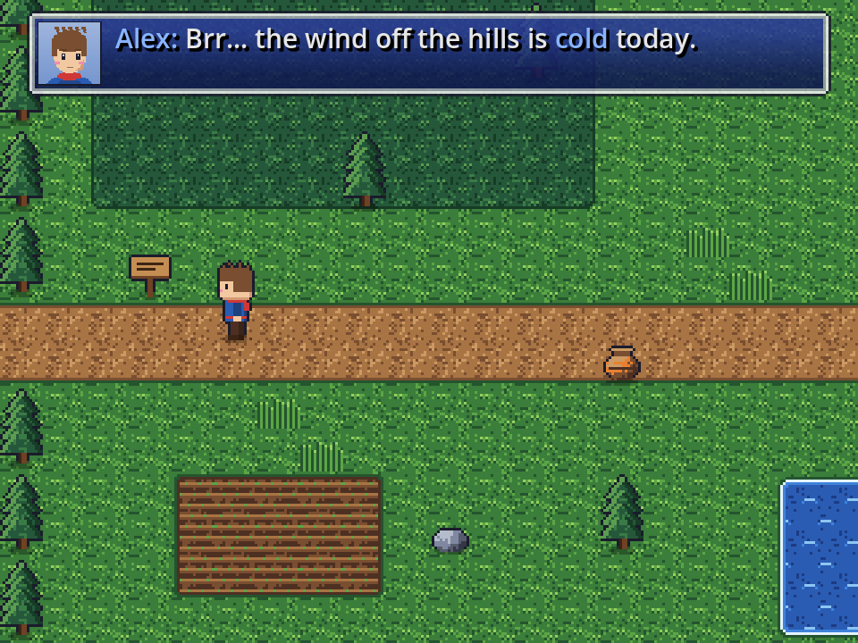

Short lines ("Brr, it's cold.") that slide in, stay a moment and fade without stopping the player, also over battles. They queue up; a repeat of the line already showing is skipped. Commands: *Show gab*, *Clear gabs*, *Wait for gabs*.

### Save & autosave plus (`save_plus`)

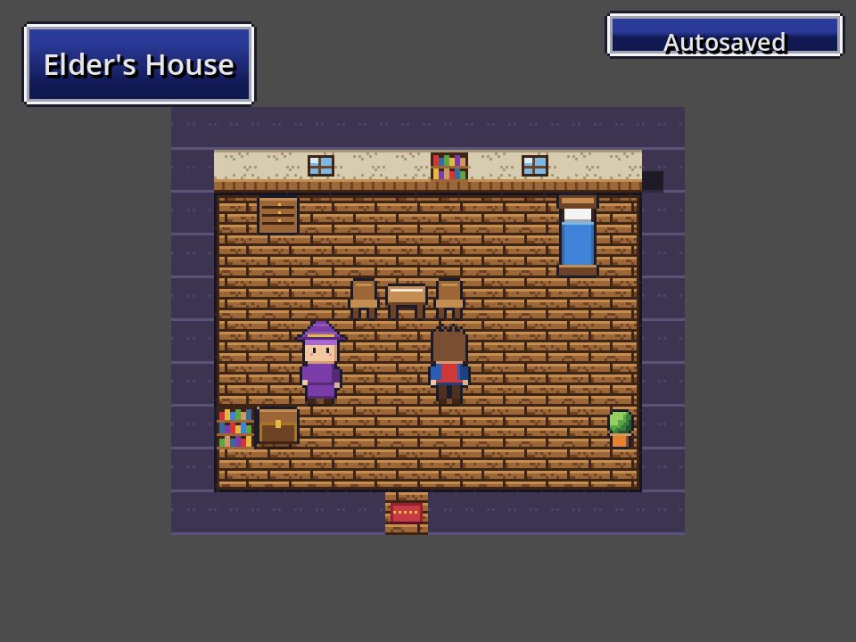

- Autosave after map transfers, after battles, or when the menu opens; an *Autosave* option for players; an "Autosaved" note.
- The number of save slots (the last one is the *Auto* slot).
- Commands: *Set save description* (a line on the save screen instead of the map name), *Request autosave*, *Change autosave*.

## Adventure

### Quest journal (`quests`)

| Journal | Tracker |
| --- | --- |
| 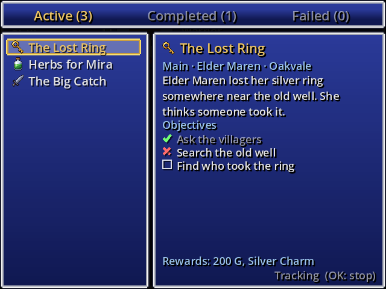 | 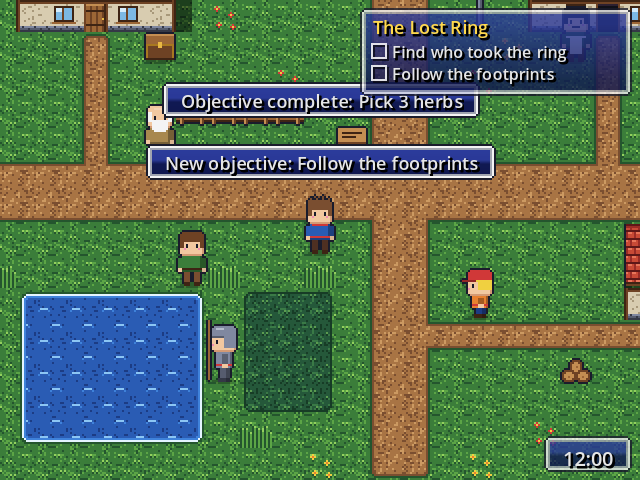 |

- A **Quests** tab in the Database: name, category, icon, giver, location, description, objectives (some hidden until an event shows them) and rewards.
- A *Quests* journal in the main menu with Active, Completed and Failed tabs. OK tracks a quest.
- A tracker on the map with the tracked quest's open objectives, and notes when a quest or objective changes.
- Condition *Quest* (event pages and Conditional Branch).
- Commands: *Set quest status*, *Set objective state*, *Track quest*, *Open quest journal*.

Your events decide when a quest starts, finishes or fails; the plugin keeps and shows the state.

### Lighting and time of day (`lighting`)

| A dark map with lights | Dusk outdoors |
| --- | --- |
| 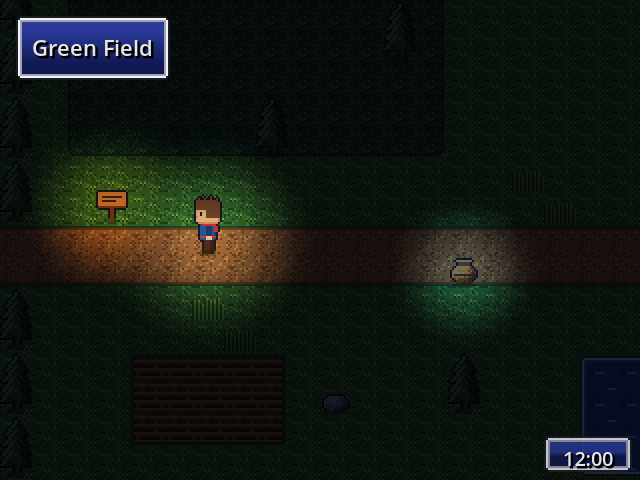 | 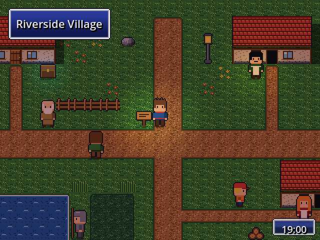 |

- **Dark maps** (Map properties > Plugin fields, or *Set darkness*), with soft **lights** on event pages (radius, colour, brightness, flicker), a light around the player and an optional flashlight cone.
- A **game clock** that tints outdoor maps by the hour (indoor maps are left alone), a clock on screen, and a *Time of day* condition.
- Commands: *Set darkness*, *Set player light*, *Set event light*, *Set time of day*, *Advance time*, *Pause time*.

### Item crafting (`crafting`)

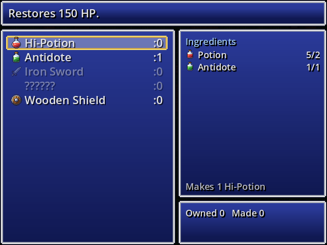

- A recipe on any item, weapon or armour (*Custom fields > Can be crafted*): ingredients and amounts, how many one craft makes, a category, and a switch that hides it.
- A *Crafting* screen in the main menu, or *Open crafting* for some categories only (a forge, a kitchen), with have/need counts and a quantity.
- Recipes stay hidden as `??????` until the party has held every ingredient.

## Battle

### Enemy HP gauges and popups (`enemy_gauges`)

| Gauges | Styled popups |
| --- | --- |
| 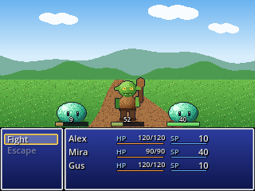 | 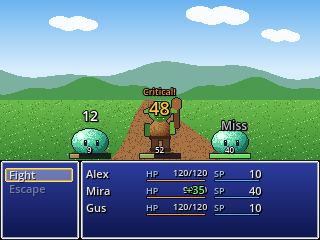 |

HP bars under enemies (always, while targeted, or once that kind of enemy has been defeated), with numbers if you like. Bosses can hide theirs. Critical hits, misses and recovery get their own popups.

### Victory aftermath (`victory_aftermath`)

| Results | Level up |
| --- | --- |
| 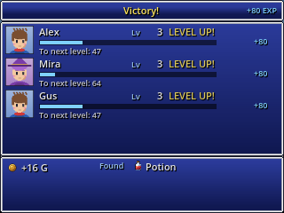 | 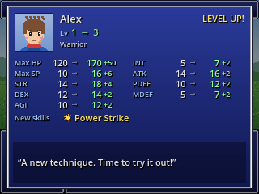 |

One results screen after a won battle (EXP bars filling per actor, gold, items), then a level-up screen per actor with old and new stats, new skills and a quote (*Level-up quotes* on Actors).

### Party formation (`party_formation`)

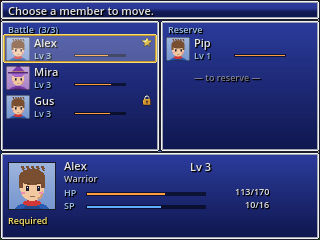

Battle members and a reserve. A *Formation* screen to swap them, locked and required members, and the number of battle members (1–4). Reserve members can get a share of the EXP. Commands: *Open formation*, *Change formation member*, *Change battle members*.

### Bestiary (`bestiary`)

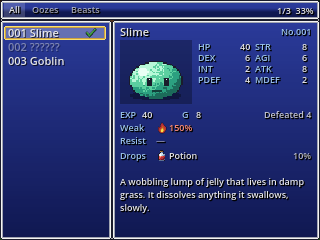

An enemy book in the menu: categories, completion, the picture, stats, weaknesses, drops and lore, masked until the enemy has been seen or defeated. Commands: *Open bestiary*, *Reveal enemy*.

## Saves

Every plugin that keeps state (quests, lighting, crafting, formation, bestiary, menu changes…) stores it in the save file in its own section, and a new game clears it. A save made before a plugin was turned on still loads.
